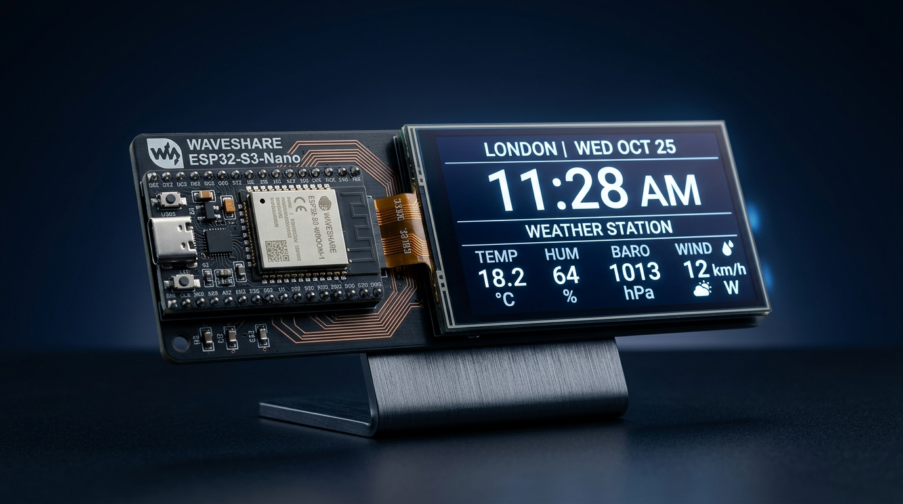
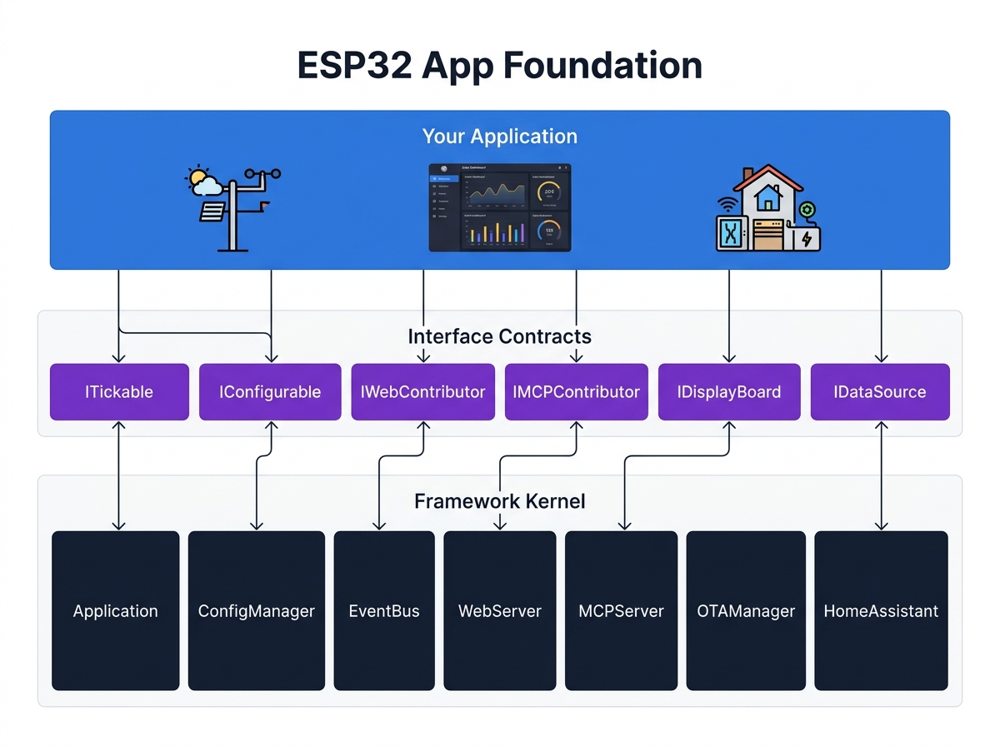
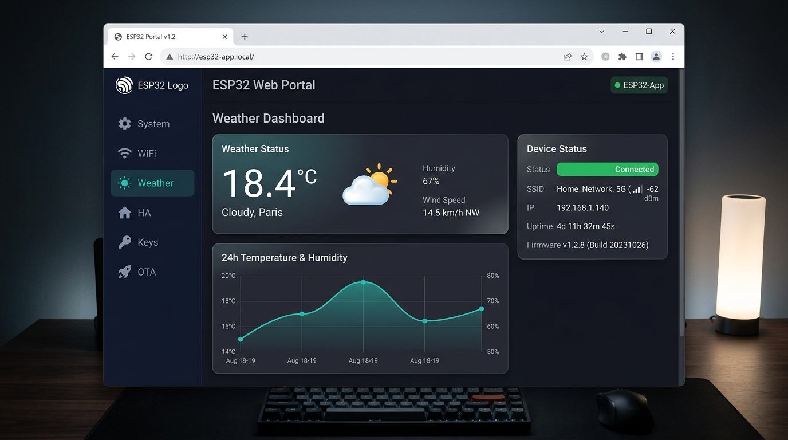
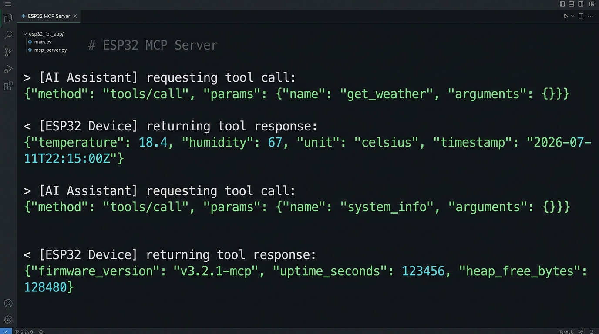
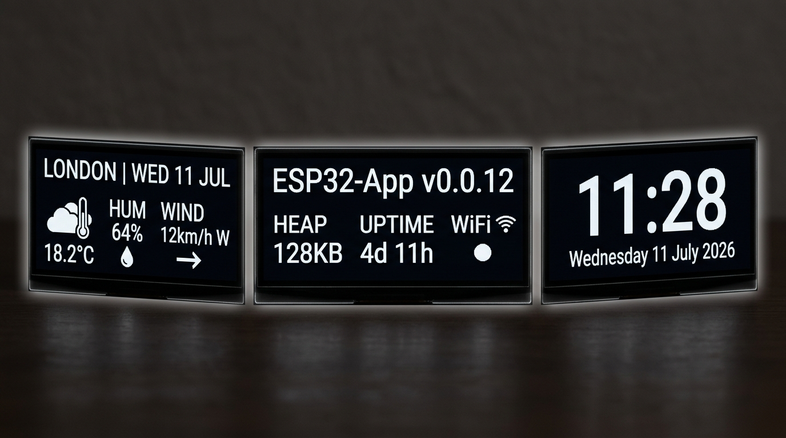
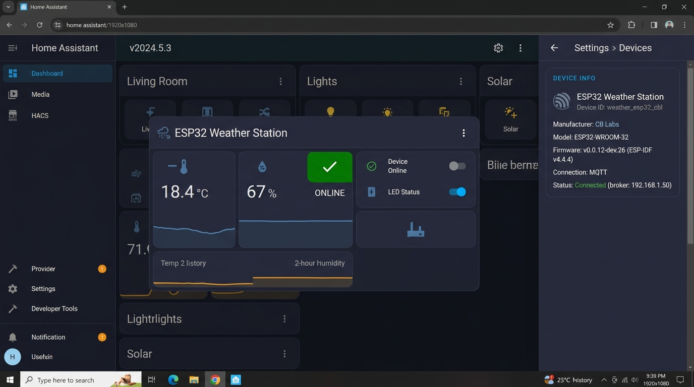
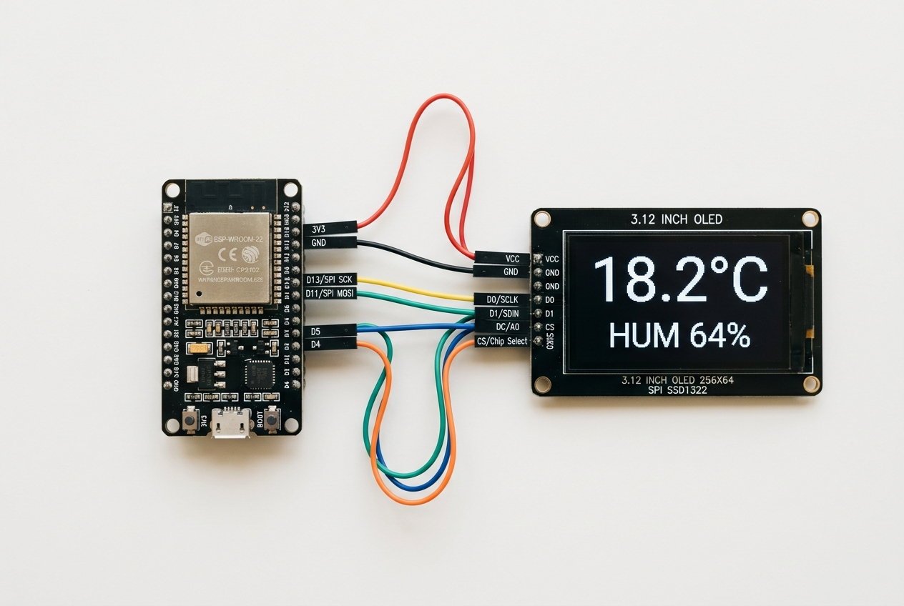
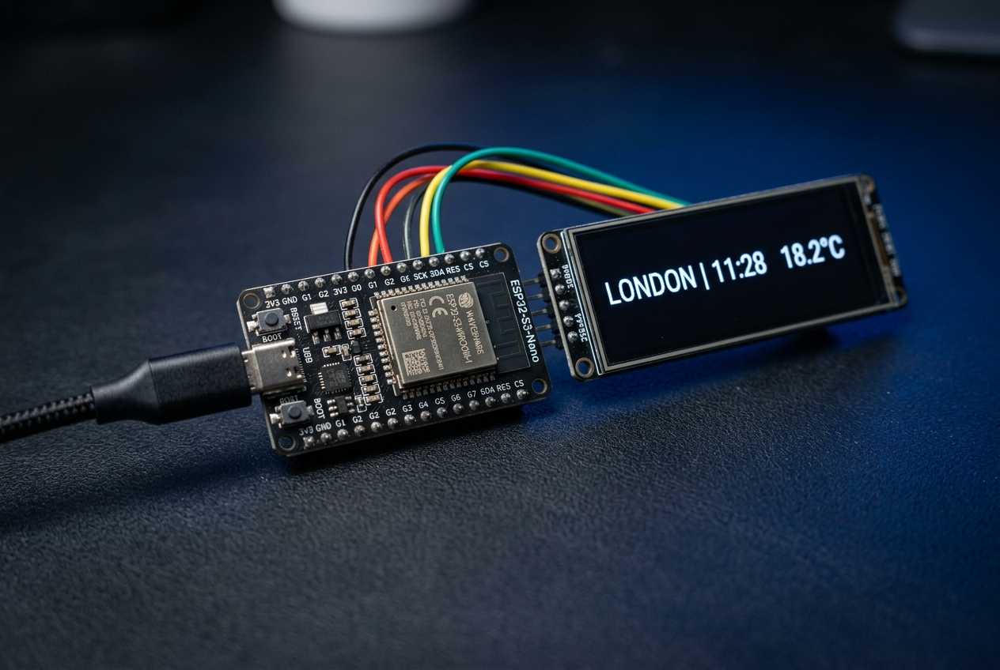

<div align="center">



# ESP32 App Foundation

**A production-ready firmware framework for ESP32 IoT devices.**

Drop in a single git submodule and get a complete, professional IoT device in hours —
not weeks. Web portal, OLED display carousel, Home Assistant integration, OTA updates,
full TLS security, and a built-in MCP server that lets AI agents query and control
your device over JSON-RPC.

[](https://creativecommons.org/licenses/by-nc-sa/4.0/)
[](https://platformio.org)
[](https://docs.espressif.com/projects/esp-idf/)
[](docs/developer/README.md)

</div>

---

## What Is This?

ESP32 App Foundation is a **composition-root firmware framework**. You write your
application as a collection of independent modules. The framework wires everything
together at startup — web routes, config persistence, OLED display boards, MQTT
entities, MCP tools — with zero boilerplate per module.

```cpp
// This is your entire main.cpp
AppFoundation app;
app.registerModule(new WeatherModule());
app.registerModule(new HomeAssistantModule());
app.begin();
```

The framework handles the rest: WiFi, mDNS, the web portal, OTA updates, display
cycling, credential encryption, and session auth. **You write the logic; the
framework provides the infrastructure.**

---

## ✨ Feature Highlights

| | |
|---|---|
| 🌐 **Full SPA Web Portal** | Module-contributed tabs, REST API, responsive UI served from LittleFS |
| 🤖 **Built-in MCP Server** | AI agents can discover and call device tools over JSON-RPC (HTTP + Serial) |
| 📟 **OLED Display Carousel** | Pluggable display boards cycle automatically; weather, clock, system stats |
| 🏠 **Home Assistant Integration** | MQTT auto-discovery with 10 entity types; zero HA configuration needed |
| 🔐 **Production Security** | AES-256 credential encryption, HTTPS portal, RSA-2048 signed OTA, JWT auth |
| 🔄 **3-Tier OTA Updates** | Signed firmware manifests with dev/beta/stable channel support |
| ⚙️ **9 Extension Interfaces** | Register once; automatically gains web routes, display, config, MCP tools |
| 📡 **EventBus** | Lightweight publish/subscribe for decoupled inter-module communication |
| 🧪 **Native Test Build** | Full module logic testable on desktop via `native` PlatformIO environment |

---

## Architecture at a Glance

The framework enforces a strict **3-tier separation** via compile-time interface contracts.
Your modules never import framework internals — they only depend on the interfaces.



```
┌─────────────────────────────────────────────┐
│              Your Application               │
│   WeatherModule  SensorModule  MyModule     │
└──────────┬──────────────────────┬───────────┘
           │  implements          │
┌──────────▼──────────────────────▼───────────┐
│            Interface Contracts              │
│  ITickable  IConfigurable  IWebContributor  │
│  IMCPContributor  IDisplayBoard  IDataSource│
└──────────┬──────────────────────┬───────────┘
           │  managed by          │
┌──────────▼──────────────────────▼───────────┐
│             Framework Kernel                │
│  Application  ConfigManager  EventBus       │
│  WebServer    MCPServer      OTAManager     │
│  HomeAssistant  KeyManager   AuthManager    │
└─────────────────────────────────────────────┘
```

---

## Capabilities

### 🌐 Web Portal

Every module that implements `IWebContributor` automatically gets a tab in the web
portal. The portal is a single-page application served directly from the device over
HTTP or HTTPS.



- **Custom tabs** — contribute HTML, REST routes, and a tab icon with a single interface
- **Responsive** — works on desktop and mobile browsers
- **HTTPS** — when auth is enabled, `WebServerManager` spins up a `PsychicHttpsServer`
  on port 443 with HTTP → HTTPS redirect on port 80
- **Built-in tabs**: System, WiFi, Keys, OTA — plus tabs from any registered modules

---

### 🤖 MCP Agent Tools

The framework runs a **Model Context Protocol (MCP) server** at `/api/mcp`. Any AI agent
with MCP support can discover available tools (`tools/list`) and call them
(`tools/call`) over JSON-RPC 2.0 — with no middleware or proxy required.



Modules register tools by implementing `IMCPContributor`. The framework-expert AI skill
(see [AI-Assisted Development](#-ai-assisted-development) below) understands the full
interface and can generate correct tool implementations from a description.

**Example tools registered by built-in modules:**

| Tool | Module | What it does |
|---|---|---|
| `system_info` | SystemModule | Returns firmware version, uptime, heap, chip info |
| `capture_display` | DisplayModule | Returns a base64 PNG of the current OLED frame |
| `wifi_get_status` | WiFiModule | Returns SSID, IP, RSSI, connection state |
| `ota_get_status` | OTAModule | Returns channel, available version, last check time |
| `ha_get_state` | HomeAssistantModule | Returns current state of a registered HA entity |
| `ha_call_service` | HomeAssistantModule | Calls an HA service (e.g. turn on a light) |

The MCP server is also served over HTTPS when TLS mode is active — no changes needed
in your module code.

---

### 📟 OLED Display Carousel

Modules implement `IDisplayBoard` to contribute a display screen. The framework's
`CarouselEngine` cycles through all registered boards automatically, with configurable
dwell times and a screensaver.



The display driver supports the **SSD1322 256×64 OLED** via U8G2. Adding a new board
is a single-class implementation — override `render(U8G2& u8g2)` and return your
screen layout.

---

### 🏠 Home Assistant Integration

The `HomeAssistantModule` provides **zero-configuration MQTT auto-discovery**. Add the
module, configure your broker address, and your device appears in Home Assistant
automatically — no YAML, no manual entity registration.



**10 built-in entity types:**

| Entity | Class | Typical use |
|---|---|---|
| Sensor | `HaSensor` | Temperature, humidity, voltage readings |
| Binary Sensor | `HaBinarySensor` | Door open/closed, motion detected |
| Switch | `HaSwitch` | Relay control, feature toggles |
| Light | `HaLight` | Dimmable LED, RGB strip |
| Climate | `HaClimate` | Thermostat set-point and mode |
| Cover | `HaCover` | Blinds, garage door position |
| Fan | `HaFan` | Fan speed control |
| Button | `HaButton` | Trigger an action (e.g. restart) |
| Number | `HaNumber` | Configurable numeric value |
| Select | `HaSelect` | Enum selection (e.g. display mode) |

**Key features:**
- **LWT (Last Will & Testament)** — device shows `offline` in HA gracefully on power loss
- **Inbound command topics** — control switches, lights, and other actuators from HA
- **Optional TLS MQTT** — supply a CA certificate, stored encrypted via `KeyManager`
- **MCP tools** — `ha_get_state` and `ha_call_service` for AI agent integration

```cpp
// Register entities in your module's begin():
_ha->addEntity(new HaSensor("temperature", "Temperature", "temperature", "°C"));
_ha->addEntity(new HaSwitch("led", "Status LED", onCommand));
```

---

### 🔐 Security

Security is layered throughout the stack — not bolted on at the end.

| Layer | Implementation |
|---|---|
| **Credential storage** | AES-256-CBC encrypted via `DeviceCrypto`; master key in hardware NVS |
| **Web portal auth** | SHA-256 salted password hash; `HttpOnly` session cookie; constant-time comparison |
| **HTTPS portal + MCP** | EC P-256 self-signed cert generated by `AuthManager`, stored in LittleFS; `PsychicHttpsServer` on port 443; HTTP port 80 redirects to HTTPS |
| **Bearer token (MCP)** | Deterministic from password hash; validated by `AuthManager` middleware |
| **External API TLS** | Explicit `setCACert()` with pinned root CAs; no Mozilla CA bundle loaded by default |
| **OTA transport** | `setInsecure()` — encrypted but unverified; firmware is RSA-2048 signed independently |
| **OTA payload** | RSA-2048 signature verification via `IOTAVerifier`; streaming SHA-256 accumulation |
| **Anti-rollback** | Monotonic `SECURITY_VERSION` counter in NVS; downgrades rejected |
| **MQTT TLS** | Optional broker CA cert stored encrypted in `KeyManager` |

> The `setInsecure()` OTA pattern is an intentional design decision: the firmware binary
> is cryptographically signed so transport verification is redundant. Payload integrity
> is a stronger guarantee than transport integrity for OTA.

---

### 🔄 OTA Updates

Firmware updates are delivered via **signed GitHub Releases** (or any HTTPS server).
The framework supports three channels — `dev`, `beta`, `stable` — and checks for updates
on a configurable schedule.

```json
// manifest.json (on your release server)
{
  "version": "1.2.3",
  "channel": "stable",
  "firmware_url": "https://github.com/you/releases/v1.2.3/firmware.bin",
  "signature":    "base64-encoded-RSA2048-signature"
}
```

The OTA tab in the web portal shows current version, available version, last check
time, and a manual trigger button.

---

## Supported Hardware

The framework supports any ESP32 board via the `board.h` mechanism. The stock boards provided (e.g., `esp32dev`, `esp32s3nano`) are **reference implementations** that exist so the framework's sample apps compile.

Consumer applications should **author their own `board.h`** (using `hardware/_TEMPLATE.board.h` as a starting point) with their app-specific pin assignments. This is the normal workflow, not an advanced override. Your board header is the single source of truth for ALL your hardware pin assignments — display, buttons, sensors, LEDs, and anything else your app needs. See the [Custom Board Authoring Guide](docs/developer/custom-boards.md) for details.

The reference implementations are tested on two boards. Both use the same 3.12″ SSD1322 OLED display.

| | ESP32-DevKit V1 | Waveshare ESP32-S3-Nano |
|---|---|---|
| **Photo** |  |  |
| **SoC** | ESP32-WROOM-32 | ESP32-S3 |
| **Flash** | 4 MB | 8 MB |
| **PSRAM** | None | 8 MB QSPI |
| **USB** | Micro-USB | USB-C |
| **PlatformIO env** | `esp32dev` | `esp32s3nano` |
| **Display CS** | IO26 | IO10 |
| **Display DC** | IO5 | IO9 |
| **SPI CLK** | IO18 | IO48 |
| **SPI MOSI** | IO23 | IO38 |

The ESP32-S3-Nano is the **recommended target** for new builds — the extra PSRAM gives
significantly more headroom for TLS handshakes, large JSON payloads, and additional modules.

📖 **[Full Hardware Setup Guide →](docs/developer/hardware-setup.md)**

---

## Quick Start

### Path A — Explore the sample app (fastest)

```bash
git clone https://github.com/matthewmcneill/esp32-app-foundation.git
cd esp32-app-foundation
pio run -e esp32dev --target upload
pio run -e esp32dev --target uploadfs
pio device monitor
```

Connect to the `ESP32-App-Setup` WiFi AP and open `http://192.168.4.1` to configure.

---

### Path B — New project via git submodule

```bash
mkdir my-device && cd my-device
git init
git submodule add https://github.com/matthewmcneill/esp32-app-foundation.git lib/esp32-app-foundation
cp lib/esp32-app-foundation/platformio.ini .
cp lib/esp32-app-foundation/src/main.cpp src/
```

Then edit `src/main.cpp` to register your modules and run:

```bash
pio run -e esp32dev --target upload
pio run -e esp32dev --target uploadfs
```

See [Architecture Overview](docs/developer/architecture-overview.md) for the module
pattern and interface contracts.

---

### Path C — Start with the sample app as a template

Clone or fork the [sample app repository](#) (coming soon) which provides a working
`WeatherStation` module as a concrete starting point.

---

## 🤖 AI-Assisted Development

The framework ships with a `framework-expert` AI skill that loads full knowledge of
the architecture, interfaces, naming conventions, and security patterns into your AI
coding assistant. The skill has been used extensively to build and extend the framework
itself.

### Install for your AI harness

**Antigravity (Google DeepMind)**
```bash
mkdir -p .agents/skills
cp -r lib/esp32-app-foundation/.agents/skills/framework-expert .agents/skills/
```

**Claude Code**
```bash
# Claude Code reads from .claude/ → symlink to .agents/ or copy directly:
mkdir -p .claude/skills
cp -r lib/esp32-app-foundation/.agents/skills/framework-expert .claude/skills/
```

**Cursor**
```bash
mkdir -p .cursor/rules
cp lib/esp32-app-foundation/.agents/skills/framework-expert/SKILL.md \
   .cursor/rules/framework-expert.md
```

Once installed, your AI assistant will automatically load framework knowledge when you
work on ESP32 App Foundation projects. Ask it to design a new module, explain an
interface contract, or generate a compliant implementation — it knows the full API.

📖 **[Skill file →](.agents/skills/framework-expert/SKILL.md)**

---

## Extension Interfaces

Implement any combination of these interfaces in your module. The framework
auto-discovers them at registration time.

| Interface | Purpose |
|---|---|
| `ITickable` | `tick(uint32_t ms)` called every loop iteration — polling, state machines |
| `IConfigurable` | Persistent JSON config in LittleFS; loaded/saved automatically |
| `IWebContributor` | Contribute REST routes and a portal tab (name, icon, order) |
| `IMCPContributor` | Register MCP tools callable by AI agents over JSON-RPC |
| `IDisplayBoard` | Contribute an OLED screen to the display carousel |
| `IDataSource` | Provide named data values consumable by other modules |
| `IOTAVerifier` | Plug in custom firmware signature verification |
| `IConfigGate` | Guard config writes with custom validation logic |
| `IHaEntity` | Home Assistant entity (sensor, switch, light, climate, …) |

A module implementing all relevant interfaces might look like:

```cpp
class WeatherModule
    : public ITickable
    , public IConfigurable
    , public IWebContributor
    , public IMCPContributor
    , public IDisplayBoard
    , public IDataSource
{
    // Each interface adds one capability — zero coupling to other modules
};
```

---

## Developer Documentation

| Document | Description |
|---|---|
| [Architecture Overview](docs/developer/architecture-overview.md) | 3-tier design, composition root, module lifecycle |
| [Hardware Setup](docs/developer/hardware-setup.md) | Wiring tables, display prep, first flash |
| [Build System](docs/developer/build-system.md) | PlatformIO environments, flags, native builds |
| [Security](docs/developer/security.md) | Credential encryption, TLS, OTA signing, auth |
| [OTA Update System](docs/developer/ota-update-system.md) | Manifest format, channels, signing workflow |
| [Web Portal](docs/developer/extending-the-web-portal.md) | IWebContributor patterns, REST conventions |
| [Display System](docs/developer/creating-a-module.md) | CarouselEngine, IDisplayBoard, U8G2 usage |
| [MCP Server](docs/developer/mcp-server.md) | IMCPContributor, JSON-RPC, tool schema |
| [EventBus](docs/developer/event-bus.md) | Publish/subscribe, topic conventions |
| [Developer README](docs/developer/README.md) | Full documentation index |

---

## Contributing

The project is under active development. Contributions, bug reports, and hardware
compatibility reports are welcome. Please read the [contributor guidelines](CONTRIBUTING.md)
before opening a pull request.

The framework-expert AI skill is available to help contributors understand the
architecture and generate compliant implementations.

---

## License

[](https://creativecommons.org/licenses/by-nc-sa/4.0/)

© 2026 CB Labs. Licensed under
[Creative Commons Attribution-NonCommercial-ShareAlike 4.0 International](https://creativecommons.org/licenses/by-nc-sa/4.0/).

You are free to use, adapt, and build on this work for non-commercial purposes, provided
you give appropriate credit and share any adaptations under the same licence.
