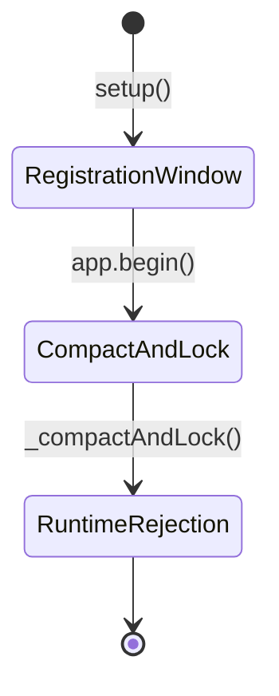
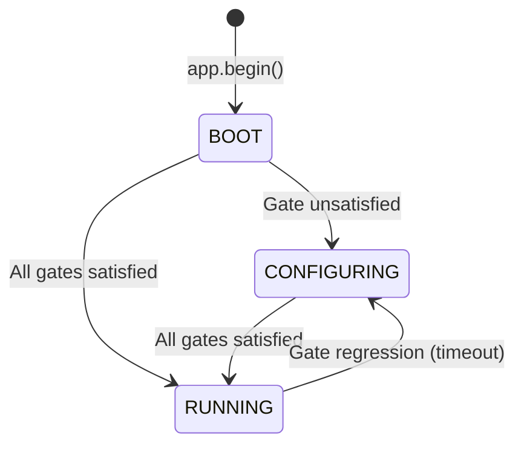

# Architecture Overview

> ESP32 App Foundation (c) 2026 CB Labs
>
> Learn about the framework's system design, the 3-tier decoupling model, the Hollywood Principle application lifecycle, and core interfaces.

---

This guide introduces the structural design of the ESP32 App Foundation framework. 

For a detailed blueprint, refer to the [System Architecture Overview](../design_specification.md#3-system-architecture-overview) in the Design Specification.

---

## 1. The 3-Tier Model

The framework decouples code into three clean layers to ensure hardware and software independence, compile-time type safety, and testability on host machines.


1. **Framework Kernel (`modules/`):** Contains core, reusable infrastructure modules like `Application`, `ConfigManager`, `EventBus`, `WifiManager`, and `WebServerManager`. The kernel does not contain application-specific logic and knows nothing about downstream code.
2. **Interfaces (`include/interfaces/`):** A collection of pure virtual C++ class contracts (e.g., [ITickable](../../include/interfaces/ITickable.hpp)). They are the only coupling point between the framework and your application.
3. **Your App (`your-project/src/` — see `sample-app/` for reference):** Implements one or more interfaces to inject custom behavior (logic, config, web pages) into the framework's execution flow.

---

## 2. The Hollywood Principle

The framework owns `setup()` and `loop()`. Downstream applications never write these functions directly. Instead, they register custom modules with the framework hub, which calls back into your code at defined lifecycle stages.

Here is the entire entry point from [main.cpp](../../sample-app/src/main.cpp) showing this pattern:

```cpp
#include "AppFoundation.h"
#ifdef ESP_PLATFORM
#include <Arduino.h>
#endif
#include "myApp.hpp"

Application app;
MyApp myApp;

void setup() {
#ifdef ESP_PLATFORM
    Serial.begin(115200);
#endif

    // Register user application modules
    app.registerModule(&myApp);  // Auto-registers for tick, config, web, MCP, preconditions

    // Prepare Framework config
    FrameworkConfig config;

    // App names its hostname default — WiFiManager owns the persisted value
    app.getWifiManager().setDefaultHostname("ESP32-App");

    // Begin framework
    app.begin(config);
}

void loop() {
    app.tick();
}
```

---

## 3. The Single Include Façade

To prevent application code from coupling directly to internal framework paths, the framework provides a single include header: [AppFoundation.h](../../include/AppFoundation.h).

This file transitively includes:
- Structural configurations ([FrameworkConfig.hpp](../../include/types/FrameworkConfig.hpp))
- Operational state enums ([AppState.hpp](../../include/types/AppState.hpp))
- All extension interfaces from `include/interfaces/`
- All event payloads from `include/events/` ([DataSourceHealthPayload.hpp](../../include/events/DataSourceHealthPayload.hpp), [PreconditionHealthPayload.hpp](../../include/events/PreconditionHealthPayload.hpp), [AppConfiguringPayload.hpp](../../include/events/AppConfiguringPayload.hpp))
- The composition root header ([Application.hpp](../../modules/Application/Application.hpp))

Downstream developers only need to include `#include "AppFoundation.h"` at the top of their files.

### Framework-Reserved Include Prefixes

The following subdirectories of `include/` are reserved by the framework:
- `events/` — EventBus payload types
- `interfaces/` — Pure interface contracts (`IDataSource`, `ITickable`, etc.)
- `platform/` — Platform abstraction layer
- `portal_assets/` — Web portal static assets
- `types/` — Framework value types (`FetchContext`, `AppState`, etc.)
- `utils/` — Framework utility headers

Consumer applications MUST NOT place headers in these directories. Use app-scoped paths instead, e.g. `include/modules/my-module/MyTypes.hpp`.

---

## 4. Compile-Time Interface Detection

The `registerModule<T>()` template in [Application.hpp](../../modules/Application/Application.hpp) uses C++ compile-time type introspection (`if constexpr` and `std::is_base_of_v`) to detect which interfaces a module implements. It automatically registers the module with all matching subsystems in a single call.

### How it works under the hood:
```cpp
template<typename T>
bool registerModule(T* module) {
    if (!module) return false;
    bool any = false;
    if constexpr (std::is_base_of_v<ITickable, T>)        { registerTickable(module);              any = true; }
    if constexpr (std::is_base_of_v<IConfigurable, T>)    { registerConfigurable(module);          any = true; }
    if constexpr (std::is_base_of_v<IWebContributor, T>)  { registerWebContributor(module);        any = true; }
    if constexpr (std::is_base_of_v<IMCPContributor, T>)  { registerMcpContributor(module);        any = true; }
    if constexpr (std::is_base_of_v<IDataSource, T>)      { registerDataSource(module);            any = true; }
    if constexpr (std::is_base_of_v<IPreconditionContributor, T>)      { registerPreconditionContributor(module);   any = true; }
    if constexpr (std::is_base_of_v<IStatusReporter, T>)  { registerStatusReporter(module);        any = true; }
    if constexpr (std::is_base_of_v<IBootReporter, T>)    { registerBootReporter(module);          any = true; }
    return any;
}
```

### Before vs After:
Instead of manually wiring a module into multiple vectors:
```cpp
// ❌ Old verbose registration (Manual wiring)
app.registerTickable(&myModule);
app.getConfigManager().registerModule(&myModule);
app.registerWebContributor(&myModule);
```
You simply call:
```cpp
//  New universal registration (Auto-detected)
app.registerModule(&myModule);
```

### Two-Tier Vector Model & `_compactAndLock()` Lifecycle

The framework stores registered modules in `std::vector` containers (one per interface type). To prevent heap fragmentation during steady-state execution, the registration system enforces a strict three-phase lifecycle:



1. **Phase 1 — Registration Window:** During `setup()`, modules are pushed into vectors via `app.registerModule()`. Vectors may reallocate and temporarily fragment the heap — this is acceptable because it occurs before long-lived runtime objects are created.

2. **Phase 2 — Compact and Lock:** Inside `app.begin()`, the framework calls `_compactAndLock()`. This method iterates through every internal vector, calls `shrink_to_fit()` to release unused capacity back to the heap, and sets `_locked = true`.

3. **Phase 3 — Runtime Rejection:** Any attempt to call `app.registerModule()` after `app.begin()` has been invoked will instantly trigger a **fatal panic**. Late registration is forbidden because pushing to a locked vector could cause a heap reallocation during steady-state execution.

> [!CAUTION]
> **Late registration causes a fatal panic.** All modules MUST be registered in `setup()` before calling `app.begin()`. If a module should be conditionally inactive, register it unconditionally and have its `tick()` return early based on internal state.

---

## 5. Platform Abstraction Strategy

The framework is designed to be fully testable on the host machine without hardware. To achieve this, it relies on a **Stub-Header Architecture** rather than littering production code with `#ifndef ESP_PLATFORM` guards.

Key principles of this strategy:
- **No Runtime Cost**: Stubs are compile-time only. Production builds link directly against the true ESP-IDF or Arduino headers.
- **No Inline Guards**: Production code remains clean and free of `#ifdef` preprocessor directives.
- **API Mirroring**: Stub headers (`test/stubs/platform/`) mirror the exact API surface of ESP-IDF and Arduino functions. During native test builds (`env:native`), the include path priority ensures the compiler resolves `#include <esp_system.h>` to the stub implementation.

For more details on how to write or update test stubs, see the [Testing Architecture](testing.md) guide.

---

## 6. ADR Rationale

Several architectural decisions underpin the framework design. These are documented as Architecture Decision Records (ADRs):

| ADR | Title | Summary |
| :--- | :--- | :--- |
| ADR-04 | Hollywood Principle | "Don't call us, we'll call you." Application modules never orchestrate boot or poll system state. They register via `app.registerModule()` and the framework calls their lifecycle methods (`tick`, `applyConfig`, `render`). |
| ADR-16 | Static Scope | All module instances MUST be declared at global or static scope. The ESP32 lacks an MMU — stack-allocated modules will silently corrupt memory or cause hard faults when the framework invokes them after `setup()` returns. |
| ADR-17 | Tick Budget | Modules MUST complete their `tick()` within **10ms**. The Task Watchdog Timer (TWDT) will panic and reboot the ESP32 if the main loop blocks for more than **5 seconds**. Lengthy operations must be deferred to FreeRTOS tasks (e.g., via `IDataSource`). Modules may override `getTickBudgetMs()` to declare a higher budget (e.g. display modules use 33 ms to match their refresh period). The default remains 10 ms. |
| [ADR](adr/adr-adapters-placement.md) | Adapters Placement | Concrete hardware adapters (e.g. `CrowPanel128Adapter`) live in a root-level `adapters/` directory, not inside `modules/` (would pollute the framework library with board-specific deps) or `hardware/` (reserved for declarative pin data). Follows the Ports & Adapters (hexagonal) pattern. |

---

## 7. Subsystem Extension Interfaces

Application modules interact with framework subsystems by implementing one or more of these interfaces:

| Interface Class | Purpose | Key Callback |
| :--- | :--- | :--- |
| [ITickable](../../include/interfaces/ITickable.hpp) | Runs periodic, non-blocking logic in the main tick loop. | `tick(uint32_t currentMillis)` |
| [IConfigurable](../../include/interfaces/IConfigurable.hpp) | Persists and loads module settings via `ConfigManager` gateway. | `applyConfig(const JsonObject&)` |
| [IWebContributor](../../include/interfaces/IWebContributor.hpp) | Exposes REST API endpoints and appends navigation tabs. | `registerRoutes(PsychicHttpServer&)` |
| [IMCPContributor](../../include/interfaces/IMCPContributor.hpp) | Registers JSON-RPC tools with the local Model Context Protocol. | `registerMCPTools(MCPToolRegistry&)` |
| [IPreconditionContributor](../../include/interfaces/IPreconditionContributor.hpp) | Registers preconditions that must be met before transition to RUNNING state. | `registerPreconditions()` |
| [IDataSource](../../include/interfaces/IDataSource.hpp) | Scheduled background data fetch worker managed by `DataManager`. | `fetchUpdate()` |
| [IStatusReporter](../../include/interfaces/IStatusReporter.hpp) | Displays boot-phase progress status and unrecoverable errors. | `reportStatus(const char*, float)` |
| [IBootReporter](../../include/interfaces/IBootReporter.hpp) | Early hardware initialisation reporter (extends `IStatusReporter`). | `beginEarly()` |
| [IDisplayModule](../../include/interfaces/IDisplayModule.hpp) | Unified display provider contract for geometry, brightness, PNG capture, and system state. | `capturePNG(Print&)` |
| [IDisplayBoard](../../modules/U8G2Display/IDisplayBoard.hpp) | Renders a telemetry pane inside the monochrome display carousel. | `render(U8G2&)` |
| [IOTAVerifier](../../include/interfaces/IOTAVerifier.hpp) | Streaming cryptographic firmware verification for OTA updates. | `verify(const uint8_t*, size_t)` |

For detailed information on implementing these interfaces, see the [Extension Points & Interfaces](../design_specification.md#6-extension-points--interfaces) section in the Design Specification.

---

## 8. The Application Lifecycle

The application operates in three main states: `BOOT` $\rightarrow$ `CONFIGURING` $\leftrightarrow$ `RUNNING`.



### 1. BOOT Phase
Executed synchronously inside `app.begin(config)`. The framework mounts the filesystem, initiates security keys, loads configuration files, and initializes core modules in strict dependency order:
- **EventBus** starts first (zero dependencies).
- **LittleFS** filesystem is mounted.
- **DeviceCrypto** and **KeyManager** initialize security keys.
- **ConfigManager** loads and applies persisted JSON configurations to all registered modules.
- **WifiManager**, **TimeManager**, **DataManager**, and **OTAUpdateManager** start up.
- Custom REST routes and MCP tools are registered.
- The registration registry is **compacted and locked** (no further registrations allowed).
- The firmware self-test passes, blessing the current boot partition.
- Boot gates are evaluated to determine the next state.

### 2. CONFIGURING Phase
Entered if any registered precondition (such as the WiFi station precondition if credentials are missing) is not satisfied.

- The `PreconditionEngine` evaluates all preconditions. Once all startup preconditions are met, the framework transitions to `RUNNING`.

### 3. RUNNING Phase
Entered once all configuration gates are satisfied.
- The framework dispatches ticks to all registered `ITickable` modules.
- A throttled check (every 5 seconds) polls gates for regression. If an actionable gate remains unsatisfied beyond its declared `getRegressionToleranceMs()` threshold, the framework regresses the system back to the `CONFIGURING` state.
- Regression is managed by the `PreconditionEngine`'s `DampingPolicy` — if a previously-met precondition regresses, damping prevents UI flapping.

For more details on the boot phases and state transitions, refer to the [Application Lifecycle](../design_specification.md#9-application-lifecycle) section in the Design Specification.

---

## 9. Flash Partition & LittleFS Directory Layout

The framework uses a **dual-partition** LittleFS layout. The custom partition table ([hardware/esp32dev/partitions.csv](../../hardware/esp32dev/partitions.csv)) defines two data partitions:

| Partition | Label | Size | Mount Point | Purpose |
| :--- | :--- | :--- | :--- | :--- |
| **config** | `config` | 256 KB | `/config` | Module configuration files (`/mod/`) and system keys (`/etc/`). |
| **storage** | `storage` | 128 KB | `/littlefs` | Static web assets (`/www/`) and other runtime data. |

At boot, `Application::begin()` mounts the `storage` partition first (at `/littlefs`), then attempts to mount the dedicated `config` partition (at `/config`). If the `config` partition is not present (e.g. on boards using a default partition table), the framework falls back to storing configuration under `/littlefs` instead.

### Directory structure
- **`/config/mod/<namespace>.json`**: Persisted configuration file for each registered `IConfigurable` module (e.g. `/config/mod/wifi.json`, `/config/mod/myapp.json`).
- **`/config/etc/`**: System-level files such as TLS keys and certificates.
- **`/littlefs/www/`**: Root directory serving assets for the Single Page Application (SPA) web portal.
- **`/littlefs/www/myapp/tab.html`** & **`/littlefs/www/myapp/tab.js`**: HTML fragment and JavaScript files dynamically fetched by the SPA to render custom tabs.

---

## 10. EventBus Overview

The framework provides a synchronous, in-memory publish-subscribe [EventBus](../../modules/EventBus/EventBus.hpp) to enable decoupled communication between modules. Modules subscribe to string-based topic channels using static function callbacks and publish events containing optional pointer payloads.

Common framework events include:
- `system.heap`: Emitted periodically with the free heap size.
- `app.running`: Published when the system successfully transitions to the RUNNING state.
- `app.configuring`: Emitted when entering CONFIGURING state with details about the blocked gate.

Learn how to leverage this in the [Event Bus Guide](event-bus.md).
