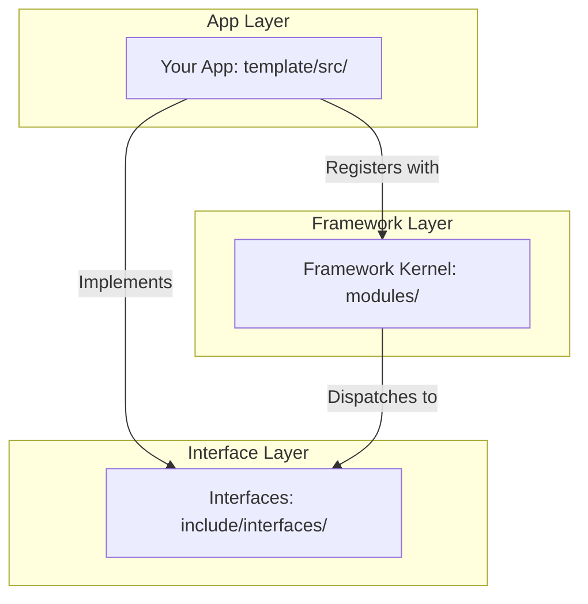
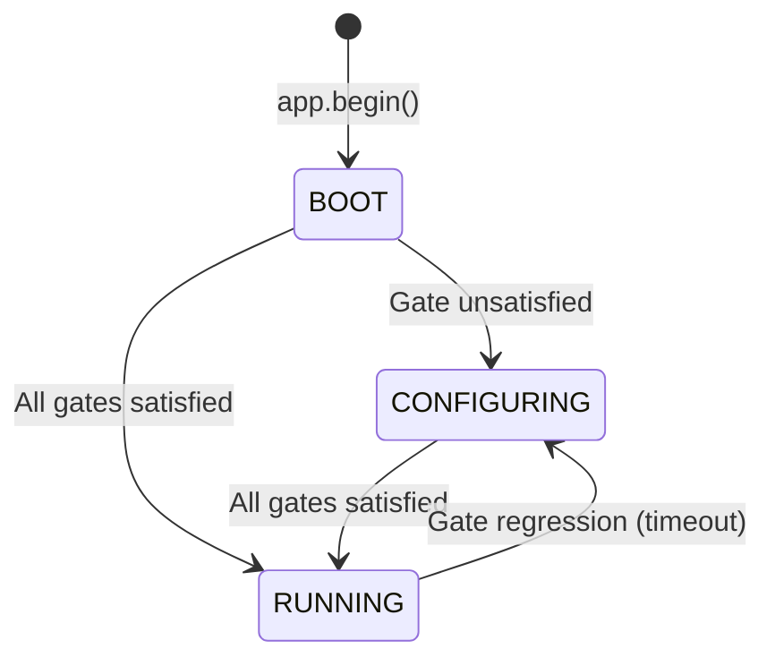

# Architecture Overview

> ESP32 App Foundation (c) 2026 CB Labs
>
> Learn about the framework's system design, the 3-tier decoupling model, the Hollywood Principle application lifecycle, and core interfaces.

---

This guide introduces the structural design of the ESP32 App Foundation framework. 

For a detailed blueprint, refer to the [System Architecture Overview](../design_specification.md#3-system-architecture-overview) in the Design Specification.

---

## 1. The 3-Tier Model

The framework decouples code into three clean layers to ensure hardware and software independence, compile-time type safety, and testability on host machines.



1. **Framework Kernel (`modules/`):** Contains core, reusable infrastructure modules like `Application`, `ConfigManager`, `EventBus`, `WifiManager`, and `WebServerManager`. The kernel does not contain application-specific logic and knows nothing about downstream code.
2. **Interfaces (`include/interfaces/`):** A collection of pure virtual C++ class contracts (e.g., [ITickable](file:///Users/mcneillm/Documents/Projects/esp32-app-foundation/include/interfaces/ITickable.hpp)). They are the only coupling point between the framework and your application.
3. **Your App (`template/src/` or downstream repo):** Implements one or more interfaces to inject custom behavior (logic, config, web pages) into the framework's execution flow.

---

## 2. The Hollywood Principle

The framework owns `setup()` and `loop()`. Downstream applications never write these functions directly. Instead, they register custom modules with the framework hub, which calls back into your code at defined lifecycle stages.

Here is the entire entry point from [main.cpp](file:///Users/mcneillm/Documents/Projects/esp32-app-foundation/template/src/main.cpp) showing this pattern:

```cpp
#include "AppFoundation.h"
#ifndef NATIVE_BUILD
#include <Arduino.h>
#endif
#include "myApp.hpp"

Application app;
MyApp myApp;

void setup() {
#ifndef NATIVE_BUILD
    Serial.begin(115200);
#endif

    // Register user application modules
    app.registerModule(&myApp);  // Auto-registers for tick, config, web, MCP, config gate

    // Prepare Framework config
    FrameworkConfig config;

    // App names its hostname default — WiFiManager owns the persisted value
    app.getWifiManager().setDefaultHostname("ESP32-App");

    // Begin framework
    app.begin(config);
}

void loop() {
    app.tick();
}
```

---

## 3. The Single Include Façade

To prevent application code from coupling directly to internal framework paths, the framework provides a single include header: [AppFoundation.h](file:///Users/mcneillm/Documents/Projects/esp32-app-foundation/include/AppFoundation.h).

This file transitively includes:
- Structural configurations ([FrameworkConfig.hpp](file:///Users/mcneillm/Documents/Projects/esp32-app-foundation/include/FrameworkConfig.hpp))
- Operational state enums ([AppState.hpp](file:///Users/mcneillm/Documents/Projects/esp32-app-foundation/include/AppState.hpp))
- All extension interfaces from `include/interfaces/`
- The composition root header ([Application.hpp](file:///Users/mcneillm/Documents/Projects/esp32-app-foundation/modules/Application/Application.hpp))

Downstream developers only need to include `#include "AppFoundation.h"` at the top of their files.

---

## 4. Compile-Time Interface Detection

The `registerModule<T>()` template in [Application.hpp](file:///Users/mcneillm/Documents/Projects/esp32-app-foundation/modules/Application/Application.hpp) uses C++ compile-time type introspection (`if constexpr` and `std::is_base_of_v`) to detect which interfaces a module implements. It automatically registers the module with all matching subsystems in a single call.

### How it works under the hood:
```cpp
template<typename T>
bool registerModule(T* module) {
    if (!module) return false;
    bool any = false;
    if constexpr (std::is_base_of_v<ITickable, T>)        { registerTickable(module);              any = true; }
    if constexpr (std::is_base_of_v<IConfigurable, T>)    { _configManager.registerModule(module); any = true; }
    if constexpr (std::is_base_of_v<IWebContributor, T>)  { registerWebContributor(module);        any = true; }
    if constexpr (std::is_base_of_v<IMCPContributor, T>)  { registerMcpContributor(module);        any = true; }
    if constexpr (std::is_base_of_v<IDataSource, T>)      { registerDataSource(module);            any = true; }
    if constexpr (std::is_base_of_v<IConfigGate, T>)      { registerConfigGate(module);            any = true; }
    if constexpr (std::is_base_of_v<IStatusReporter, T>)  { registerStatusReporter(module);        any = true; }
    // ...
    return any;
}
```

### Before vs After:
Instead of manually wiring a module into multiple vectors:
```cpp
// ❌ Old verbose registration (Manual wiring)
app.registerTickable(&myModule);
app.getConfigManager().registerModule(&myModule);
app.registerWebContributor(&myModule);
```
You simply call:
```cpp
//  New universal registration (Auto-detected)
app.registerModule(&myModule);
```

---

## 5. Subsystem Extension Interfaces

Application modules interact with framework subsystems by implementing one or more of these interfaces:

| Interface Class | Purpose | Key Callback |
| :--- | :--- | :--- |
| [ITickable](file:///Users/mcneillm/Documents/Projects/esp32-app-foundation/include/interfaces/ITickable.hpp) | Runs periodic, non-blocking logic in the main tick loop. | `tick(uint32_t currentMillis)` |
| [IConfigurable](file:///Users/mcneillm/Documents/Projects/esp32-app-foundation/include/interfaces/IConfigurable.hpp) | Persists and loads module settings via `ConfigManager` gateway. | `applyConfig(const JsonObject&)` |
| [IWebContributor](file:///Users/mcneillm/Documents/Projects/esp32-app-foundation/include/interfaces/IWebContributor.hpp) | Exposes REST API endpoints and appends navigation tabs. | `registerRoutes(PsychicHttpServer&)` |
| [IMCPContributor](file:///Users/mcneillm/Documents/Projects/esp32-app-foundation/include/interfaces/IMCPContributor.hpp) | Registers JSON-RPC tools with the local Model Context Protocol. | `registerMCPTools(MCPToolRegistry&)` |
| [IConfigGate](file:///Users/mcneillm/Documents/Projects/esp32-app-foundation/include/interfaces/IConfigGate.hpp) | Blocks transition to RUNNING state until requirements are satisfied. | `isSatisfied()` |
| [IDataSource](file:///Users/mcneillm/Documents/Projects/esp32-app-foundation/include/interfaces/IDataSource.hpp) | Scheduled background data fetch worker managed by `DataManager`. | `fetchUpdate()` |
| [IStatusReporter](file:///Users/mcneillm/Documents/Projects/esp32-app-foundation/include/interfaces/IStatusReporter.hpp) | Displays boot-phase progress status and unrecoverable errors. | `reportStatus(const char*, float)` |
| [IDisplayBoard](file:///Users/mcneillm/Documents/Projects/esp32-app-foundation/include/interfaces/IDisplayBoard.hpp) | Renders a telemetry pane inside the monochrome display carousel. | `render(U8G2&)` |

For detailed information on implementing these interfaces, see the [Extension Points & Interfaces](../design_specification.md#6-extension-points--interfaces) section in the Design Specification.

---

## 6. The Application Lifecycle

The application operates in three main states: `BOOT` $\rightarrow$ `CONFIGURING` $\leftrightarrow$ `RUNNING`.



### 1. BOOT Phase
Executed synchronously inside `app.begin(config)`. The framework mounts the filesystem, initiates security keys, loads configuration files, and initializes core modules in strict dependency order:
- **EventBus** starts first (zero dependencies).
- **LittleFS** filesystem is mounted.
- **DeviceCrypto** and **KeyManager** initialize security keys.
- **ConfigManager** loads and applies persisted JSON configurations to all registered modules.
- **WifiManager**, **TimeManager**, **DataManager**, and **OTAUpdateManager** start up.
- Custom REST routes and MCP tools are registered.
- The registration registry is **compacted and locked** (no further registrations allowed).
- The firmware self-test passes, blessing the current boot partition.
- Boot gates are evaluated to determine the next state.

### 2. CONFIGURING Phase
Entered if any registered `IConfigGate` (such as the default `WifiConfigGate` if the station credentials are missing) returns `isSatisfied() == false`.
- Ticks are still dispatched to all modules (WiFi stays active, display displays a configuration progress board, and the local portal is open).
- The tick loop polls config gates. Once all gates are satisfied, the framework transitions to `RUNNING`.

### 3. RUNNING Phase
Entered once all configuration gates are satisfied.
- The framework dispatches ticks to all registered `ITickable` modules.
- A throttled check (every 5 seconds) polls gates for regression. If an actionable gate remains unsatisfied beyond its declared `getRegressionToleranceMs()` threshold, the framework regresses the system back to the `CONFIGURING` state.

For more details on the boot phases and state transitions, refer to the [Application Lifecycle](../design_specification.md#9-application-lifecycle) section in the Design Specification.

---

## 7. LittleFS Directory Layout

All persistent files are stored in the flash memory via LittleFS. The framework expects a strict structure:
- **`/mod/<namespace>.json`**: Stored configuration file for each registered `IConfigurable` module (e.g. `/mod/wifi.json`, `/mod/myapp.json`).
- **`/www/`**: Root directory serving assets for the Single Page Application (SPA) web portal.
- **`/www/myapp/tab.html`** & **`/www/myapp/tab.js`**: HTML fragment and JavaScript files dynamically fetched by the SPA to render custom tabs.

---

## 8. EventBus Overview

The framework provides a synchronous, in-memory publish-subscribe [EventBus](file:///Users/mcneillm/Documents/Projects/esp32-app-foundation/modules/EventBus/EventBus.hpp) to enable decoupled communication between modules. Modules subscribe to string-based topic channels using static function callbacks and publish events containing optional pointer payloads. 

Common framework events include:
- `system.heap`: Emitted periodically with the free heap size.
- `app.running`: Published when the system successfully transitions to the RUNNING state.
- `app.configuring`: Emitted when entering CONFIGURING state with details about the blocked gate.

Learn how to leverage this in the [Event Bus Guide](event-bus.md).
