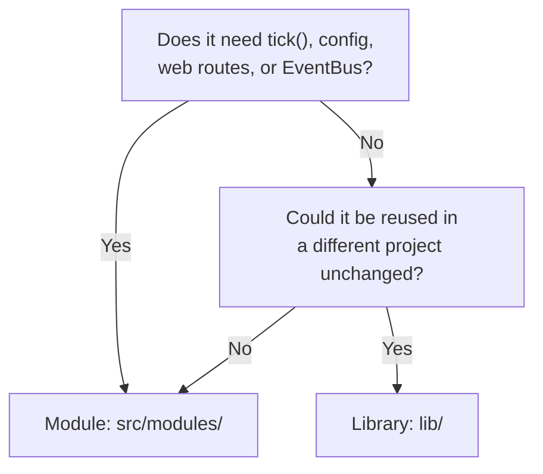
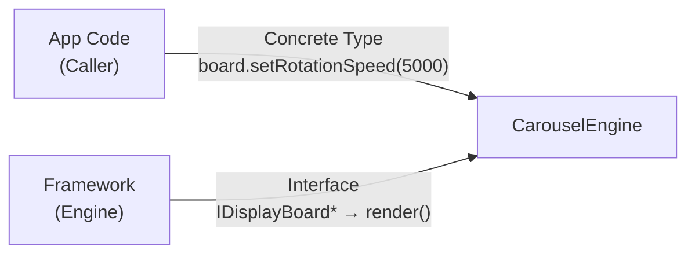

# Coding Patterns & Best Practices

> ESP32 App Foundation (c) 2026 CB Labs
>
> Decision frameworks, architectural patterns, and naming conventions for writing clean, maintainable modules.

---

This guide covers the fundamental coding patterns enforced by the ESP32 App Foundation. These patterns exist to keep a long-running embedded system stable, testable, and extensible over its entire lifetime.

**Prerequisites:** Read the [Architecture Overview](architecture-overview.md) and [Creating a Module](creating-a-module.md) first.

---

## 1. Modules vs Libraries

The codebase draws a hard line between **Modules** and **Libraries**. Understanding the distinction prevents incorrect placement of code and ensures the dependency graph stays clean.

| Aspect | Module | Library |
| :--- | :--- | :--- |
| **Role** | Active, application-aware domain entity with lifecycle hooks | Passive, application-agnostic utility |
| **Location** | `src/modules/` (app) or `modules/` (framework) | `lib/` |
| **Registration** | Registered with `Application` via `registerModule()` | Not registered — instantiated and called directly |
| **Lifecycle** | Driven by `tick()`, receives config, contributes web routes | No `tick()`, no registration, no framework callbacks |
| **Dependencies** | Can depend on other modules, libraries, and framework events | Must **never** depend on application modules |
| **Examples** | `OTAUpdateManager`, `ConfigManager`, `WifiManager` | `DeviceCrypto`, `MD5Utils` |

### The Decision Test

Ask yourself two questions:

1. **Does this component need to know about the EventBus or application state?** → It's a Module.
2. **Could this component be dropped into a completely different project unchanged?** → It's a Library.



> [!IMPORTANT]
> Libraries must never `#include` application module headers. If a library needs application context, it has graduated to being a Module.

---

## 2. SOLID Principles in the Framework

The framework's architecture directly maps to each of the five SOLID principles. This isn't academic — every principle prevents a specific class of embedded bug.

### Single Responsibility Principle (SRP)

> *A module must have a single reason to change.*

Each interface represents exactly one concern. The `ConfigManager` handles persistence *routing*, but the modules themselves own their configuration structure via [IConfigurable](file:///Users/mcneillm/Documents/Projects/esp32-app-foundation/include/interfaces/IConfigurable.hpp). This means adding a new config field to `WifiManager` never requires modifying `ConfigManager`.

### Open/Closed Principle (OCP)

> *Open for extension, closed for modification.*

You extend the framework by creating new modules that implement interfaces — you never modify the `Application` class. Need a new web tab? Implement [IWebContributor](file:///Users/mcneillm/Documents/Projects/esp32-app-foundation/include/interfaces/IWebContributor.hpp). Need a new background data fetch? Implement [IDataSource](file:///Users/mcneillm/Documents/Projects/esp32-app-foundation/include/interfaces/IDataSource.hpp). The framework core doesn't change.

### Liskov Substitution Principle (LSP)

> *Any implementation of an interface must be perfectly substitutable.*

The `CarouselEngine` can accept any [IDisplayBoard](file:///Users/mcneillm/Documents/Projects/esp32-app-foundation/include/interfaces/IDisplayBoard.hpp) without knowing its concrete type. A `WeatherBoard` and an `ErrorBoard` are interchangeable from the engine's perspective — both implement `render(U8G2&)`, `isExpired()`, `getBoardName()`, `onActivate()`, `onDeactivate()`, and `tick(uint32_t)`.

### Interface Segregation Principle (ISP)

> *No module should be forced to implement interfaces it doesn't use.*

Instead of a monolithic `IModule` super-interface, the framework provides granular capability contracts:

| Interface | Purpose |
| :--- | :--- |
| [ITickable](file:///Users/mcneillm/Documents/Projects/esp32-app-foundation/include/interfaces/ITickable.hpp) | `tick(uint32_t currentMillis)` — periodic main-loop execution |
| [IConfigurable](file:///Users/mcneillm/Documents/Projects/esp32-app-foundation/include/interfaces/IConfigurable.hpp) | `applyConfig(const JsonObject&)` — config persistence |
| [IWebContributor](file:///Users/mcneillm/Documents/Projects/esp32-app-foundation/include/interfaces/IWebContributor.hpp) | `registerRoutes(PsychicHttpServer&)` — REST API routes |
| [IMCPContributor](file:///Users/mcneillm/Documents/Projects/esp32-app-foundation/include/interfaces/IMCPContributor.hpp) | `registerMCPTools(MCPToolRegistry&)` — JSON-RPC tools |
| [IConfigGate](file:///Users/mcneillm/Documents/Projects/esp32-app-foundation/include/interfaces/IConfigGate.hpp) | `isSatisfied()` — boot prerequisites |
| [IDataSource](file:///Users/mcneillm/Documents/Projects/esp32-app-foundation/include/interfaces/IDataSource.hpp) | `fetchUpdate()` — background data fetching |

A module that only needs periodic execution implements `ITickable` alone — it never touches config or web routes.

### Dependency Inversion Principle (DIP)

> *Depend on abstractions, not concretions.*

The `Application` class depends on `ITickable*`, `IConfigurable*`, `IWebContributor*` — not on `MyWeatherModule` or `MySensorModule`. Dependencies are injected during the `begin()` phase.

**Deferred DIP Interfaces:** We pragmatically defer abstracting components that have a **single, concrete implementation** (e.g., `DeviceCrypto`). Creating an `ICryptography` interface when only one crypto backend exists adds boilerplate without architectural value. We use the concrete type directly until a second implementation is actually needed.

### Dependency Injection Conventions

The framework strictly avoids global state and `extern` instances. Instead, dependencies must be explicitly injected:

- **Constructor Injection:** For mandatory dependencies required for the object to be in a valid state.
- **`begin()` Injection:** For framework-level dependencies (like the `EventBus` or `ConfigManager`) that are resolved during the application bootstrap phase.

#### The Transient Service Locator Pattern (ADR-39)

Framework modules receive `Application&` as a **transient service locator** in `begin()`. The module uses `Application&` to extract and store narrow references to only the specific services it needs. The `Application` reference is **never stored** — it is used once during wiring and discarded.

```cpp
// ✅ Correct: Transient Service Locator — standardised begin(), narrow stored refs
// In the header:
class Application;  // Forward declaration only — no #include

class MyModule : public ITickable {
public:
    void begin(Application& app);   // Standardised signature
private:
    EventBus*      _bus  = nullptr;   // ← narrow stored ref
    ConfigManager* _cfg  = nullptr;   // ← narrow stored ref
    // NO Application* member
};

// In the .cpp:
#include "Application.hpp"   // Only #include'd in .cpp, never in .hpp

void MyModule::begin(Application& app) {
    _bus = &app.getEventBus();
    _cfg = &app.getConfigManager();
    _bus->subscribe("app.running", onAppRunning, this);
}
```

```cpp
// ❌ Wrong: Storing Application* as a member
class MyModule {
    Application* _app = nullptr;  // NEVER do this
    void begin(Application& app) { _app = &app; }
    void tick(uint32_t ms) { _app->getEventBus().publish(...); }  // Ongoing coupling
};

// ❌ Wrong: Global state access
extern EventBus globalBus;  // Never do this
```

**Key rules:**
1. `begin(Application& app)` is the standard module bootstrap signature.
2. Inside `begin()`, extract only the services the module actually needs.
3. **Never** store `Application*` or `Application&` as a class member.
4. `#include "Application.hpp"` must appear only in the `.cpp`, never in the `.hpp`.
5. The stored private members serve as the self-documenting dependency list.

---

## 3. Hierarchical Object Model (HOM)

The Hierarchical Object Model pattern governs how modules expose their internal components. Rather than flattening everything into a single god-object, modules expose their meaningful parts as a navigable object hierarchy.

### The Domain Meaning Test

A sub-object should be exposed publicly if and only if it passes the **Domain Meaning Test**:

> *Does this sub-object have meaningful identity and purpose independent of its parent?*

**Pass — Expose as a navigable sub-object:**

| Expression | Why it passes |
| :--- | :--- |
| `displayModule.carousel` | A carousel is a distinct domain entity with its own configuration (rotation speed, board list). |
| `webPortal.authManager` | Authentication is an independently meaningful domain concept. |

**Fail — Hide behind parent methods:**

| Expression | Why it fails |
| :--- | :--- |
| `displayModule.carousel.internalTimer` | Implementation detail — not a domain concept. |
| `displayModule.screen.spiBus` | Hardware mechanic — not something callers should configure directly. |

### Concrete at Caller, Interface at Engine

This is the most critical rule for building usable hierarchies:

1. **Caller → Sub-object**: Return the **concrete type**. The caller needs the full, specific API to configure the object (e.g., `board.setTheme()`).
2. **Engine → Sub-object**: The framework execution engine operates on the **interface** (e.g., `IDisplayBoard*`). It only needs polymorphic behaviour (`render()`, `tick()`).



### The Two-Step Smell

If a caller must configure a sub-object AND separately tell the parent to update/surface it for that configuration change to take effect, the hierarchy is broken.

```cpp
// ❌ Two-Step Smell: broken hierarchy
carousel.setRotationSpeed(5000);
displayModule.applyCarouselSettings();  // Why is this needed?

// ✅ Clean hierarchy: configure directly, parent reacts automatically
carousel.setRotationSpeed(5000);  // Takes effect immediately
```

Configuration should happen directly on the sub-object, and the parent should react automatically or via a single clear presentation command.

### Layered Subsystem Priority

When a module manages multiple layers of content (like the display module), define an explicit priority stack:

| Priority | Layer | Example | Control |
| :--- | :--- | :--- | :--- |
| **Highest** | Transient Overlay | Error alerts, OTA progress | App-driven, short-lived |
| **Mid** | Primary Content | Active dashboard or carousel | App-driven, persistent |
| **Lowest** | Idle / Background | Screensaver | System-driven inactivity |

> [!CAUTION]
> The idle policy must **never** be implemented as a transient overlay, or it could suppress legitimate application alerts.

---

## 4. Service Module Pattern (SMP)

A well-designed module is a **service provider**: it accepts commands and executes them. It does not make decisions on behalf of the application about *when* those commands should be issued. When a module starts making application-level lifecycle decisions, it has fallen into the **Orchestrator Anti-Pattern**.

### The 4 Symptoms of the Orchestrator Anti-Pattern

Look for these warning signs in your code:

| # | Symptom | Example |
| :--- | :--- | :--- |
| 1 | **Polling external state in `tick()`** | `if (systemState == AppState::Booting) { ... }` |
| 2 | **Holding a hub reference** | Module stores a pointer to `Application*` |
| 3 | **Domain logic leakage** | Comments like "prevent race conditions from event ordering" |
| 4 | **Embedded state machines** | `tick()` contains phase-transition `if/switch` chains for the whole application |

### Correct Inversion

All "when to do what" decisions must be pushed upstream to the `Application` or a dedicated Coordinator. The service module's `tick()` should only handle its own timers, advance its own state, and produce its output.

```cpp
// ❌ Orchestrator Anti-Pattern: Module making app-level decisions
void MyModule::tick(uint32_t now) {
    if (_app->getState() == AppState::Running) {
        if (_app->getWifiManager().isConnected()) {
            fetchData();  // Module deciding WHEN to fetch
        }
    }
}

// ✅ Service Module Pattern: Upstream tells module when to act
void MyModule::tick(uint32_t now) {
    if (_fetchRequested.load()) {
        fetchData();
        _fetchRequested.store(false);
    }
}
```

### The Service-Intrinsic Exception

Autonomous behaviour is acceptable if it is **service-intrinsic** — meaning it concerns only the service's own hardware or internal resource management.

| Decision | Where it belongs |
| :--- | :--- |
| "Dim the screen after 30s inactivity" | ✅ Service-intrinsic (display's own hardware) |
| "Dim the screen because the network disconnected" | ❌ Upstream (requires app domain knowledge) |

### Coupling Audit Table

Use this table to evaluate a module's dependencies:

| Dependency found in module | Verdict |
| :--- | :--- |
| EventBus publish/subscribe | ✅ Acceptable — reactive/notifying, not orchestrating |
| Own configuration via `IConfigurable` | ✅ Acceptable — self-management |
| Web/API routes via `IWebContributor` | ✅ Acceptable — exposing own endpoints |
| `Application` hub or god-object reference | ⚠️ Smell — why does it need the whole application? |
| System / application state enum | ⚠️ Smell — should not know about app phases |
| Sibling module's concrete class | ❌ Orchestrator Anti-Pattern — tight coupling |
| Unrelated business domain services | ❌ Orchestrator Anti-Pattern — wrong layer |

> [!NOTE]
> The `OTAUpdateManager` currently still holds an `Application` reference. This is a known technical debt item slated for a future refactor, making it the sole remaining violation of this pattern in the core framework.

---

## 5. Style Guide

### Naming Conventions

| Category | Convention | Example |
| :--- | :--- | :--- |
| Classes / Structs | PascalCase | `ConfigManager`, `FrameworkConfig` |
| Interfaces | PascalCase with `I` prefix | `ITickable`, `IWebContributor` |
| Enums | `enum class`, PascalCase | `enum class AppState` |
| Enum values | PascalCase | `AppState::Running` |
| Methods / Functions | camelCase | `void getData()`, `bool isReady()` |
| Variables | camelCase | `int retryCount` |
| Member variables | camelCase with `_` prefix | `int _retryCount` |
| Constants / Macros | SCREAMING_SNAKE_CASE | `MAX_RETRY_COUNT` |

### Acronym Rule

Acronyms and initialisms **preserve their canonical uppercase casing** when embedded in PascalCase names. The exception is `WiFi`, which retains its mixed casing to match the ESP32 SDK.

```cpp
// ✅ Correct acronym handling
class OTAUpdateManager;   // OTA stays uppercase
class MCPServer;           // MCP stays uppercase
class TLSCertManager;      // TLS stays uppercase
MCPServer* _mcpServer;     // camelCase member, acronym lowercase prefix

// ❌ Incorrect
class OtaUpdateManager;    // Don't camelCase acronyms in class names
class McpServer;
```

### Directory ↔ File ↔ Class Alignment

The directory, primary file, and primary class must all use the exact same PascalCase name. This eliminates mixed-casing in `#include` paths.

```
class ConfigManager  →  ConfigManager/ConfigManager.hpp
class ITickable      →  ITickable.hpp  (interfaces don't need their own directory)
```

### Module Header Template

Every `.hpp` and `.cpp` file must begin with a standard header block. When a class implements interfaces, group the exported methods by the interface they fulfil:

```cpp
/*
 * ESP32 App Foundation (c) 2026
 *
 * Module: src/modules/MyModule/MyModule.hpp
 * Description: Manages the custom sensor hardware and reports metrics.
 *
 * Exported Classes:
 * - MyModule: Main sensor controller
 *
 *   Lifecycle:
 *   - begin():       Initialises sensor hardware
 *
 *   Own Public API:
 *   - readSensor():  Triggers a manual read
 *
 *   ITickable:
 *   - tick():        Polls sensor data
 *
 *   IConfigurable:
 *   - applyConfig(): Applies calibration offsets
 */
```

### Doxygen Documentation

Use Doxygen-style block comments (`/** ... */`) for all public declarations. Include `@brief`, `@param`, and `@return` tags for complex methods:

```cpp
/**
 * @brief Read the current sensor value with optional averaging.
 *
 * @param samples Number of readings to average (1-16). Default: 1.
 * @return The averaged sensor reading in raw ADC counts, or -1 on error.
 */
int readSensor(int samples = 1);
```

### NATIVE_BUILD Stubs

When providing mock/stub definitions for native testing (under `#ifdef NATIVE_BUILD`), define the stub in **exactly one authoritative header file** and use forward declarations everywhere else. This prevents redefinition errors during the build process.

---

## 6. Common Anti-Patterns

These patterns have been tested and explicitly rejected. Each one causes a specific class of failure in long-running embedded systems.

### Anti-Pattern 1: Global State & Hub References

**What it looks like:**
```cpp
extern Application app;       // ❌ Global state
extern EventBus globalBus;    // ❌ Global state

void MyModule::tick(uint32_t now) {
    globalBus.publish("my.event", nullptr);  // ❌ Implicit dependency
}
```

**Why it's wrong:** Global state makes dependencies invisible, prevents unit testing, and creates hidden coupling. On a multi-core ESP32, unsynchronised globals are a data-race waiting to happen.

**What to do instead:** Inject dependencies via constructor or `begin()`. See [Section 2: Dependency Injection Conventions](#dependency-injection-conventions).

---

### Anti-Pattern 2: Monolithic Config

**What it looks like:**
```cpp
// ❌ One giant struct holding every module's settings
struct AppConfig {
    char wifiSsid[64];
    int displayBrightness;
    char apiKey[128];
    int refreshInterval;
    // ... grows forever
};
```

**Why it's wrong:** Violates SRP and OCP. Every time a module is added, the central config must change. Serialising the entire struct requires a massive contiguous memory allocation.

**What to do instead:** Each module implements [IConfigurable](file:///Users/mcneillm/Documents/Projects/esp32-app-foundation/include/interfaces/IConfigurable.hpp) and owns its own config structure. The `ConfigManager` routes persistence to `/mod/<namespace>.json` files. See [Config System](config-system.md).

---

### Anti-Pattern 3: `std::function` Heap Fragmentation (GRAVE-05)

**What it looks like:**
```cpp
// ❌ EventBus using std::function callbacks
bus.subscribe("topic", std::function<void(const char*, void*)>(
    [this, extraContext](const char* topic, void* data) {
        handleEvent(topic, data, extraContext);  // Captures exceed SBO
    }
));
```

**Why it's wrong:** The ESP32's Small Buffer Optimisation (SBO) threshold is typically 16 bytes. Capturing more than a pointer or two in a lambda forces a **hidden heap allocation** inside `std::function`. In a 24/7 system with hundreds of subscribe/unsubscribe cycles, this causes catastrophic heap fragmentation and eventual OOM.

**What to do instead:** The framework's `EventBus` uses static function pointers with a `void*` context parameter for guaranteed zero-allocation routing:

```cpp
// ✅ Static function pointer — zero allocation
static void onHeapUpdate(const char* topic, void* data, void* context) {
    auto* self = static_cast<MyModule*>(context);
    self->handleHeapUpdate(data);
}

bus.subscribe("system.heap", onHeapUpdate, this);
```

---

### Anti-Pattern 4: Late Registration

**What it looks like:**
```cpp
void MyModule::tick(uint32_t now) {
    if (_needsNewBoard && !_boardRegistered) {
        app.registerModule(&_dynamicBoard);  // ❌ After begin()!
        _boardRegistered = true;
    }
}
```

**Why it's wrong:** Registering after `app.begin()` introduces race conditions and makes the initialisation sequence unpredictable. The framework **locks** all registration vectors at the end of `begin()`.

**What to do instead:** Register all modules and interfaces during the deterministic `setup()` phase, before `app.begin()` is called. If you need dynamic content, use a registered module that internally manages its own sub-objects.

---

### Anti-Pattern 5: Stack-Allocated Modules (ADR-16)

**What it looks like:**
```cpp
void setup() {
    MyApp myApp;                    // ❌ Stack-allocated — goes out of scope!
    app.registerModule(&myApp);
    app.begin(config);
}  // myApp destroyed here — dangling pointer in registry
```

**Why it's wrong:** The `loop()` function runs forever. If a module is stack-allocated inside `setup()` and goes out of scope, the framework's registry holds a dangling pointer. The next `tick()` call is undefined behaviour.

**What to do instead:** Instantiate all modules with static or global scope:

```cpp
Application app;
MyApp myApp;  // ✅ Global scope — outlives tick() loop

void setup() {
    app.registerModule(&myApp);
    app.begin(config);
}
```

> [!WARNING]
> The ESP32 has no MMU (Memory Management Unit). There is no hardware protection against use-after-free. A dangling pointer silently corrupts memory until the device crashes hours or days later.

---

### Anti-Pattern 6: Unified `IDisplayDriver` (ADR-02)

**What was proposed:** A single interface abstracting U8G2 (OLED), TFT_eSPI (colour TFT), and e-ink libraries behind one universal driver.

**Why it was rejected:** The lowest-common-denominator approach ruins the unique capabilities of each display type. E-ink requires damage-rect partial refresh. TFT supports 16-bit colour. OLED uses 1-bit buffers. No single interface captures all three without becoming a leaky abstraction.

**What to do instead:** Use the concrete driver directly (e.g., `U8G2` for OLED displays via [IDisplayBoard](file:///Users/mcneillm/Documents/Projects/esp32-app-foundation/include/interfaces/IDisplayBoard.hpp)). If swapping display hardware, replace the entire Display Module rather than trying to abstract behind a universal driver.

---

## See Also

- [Architecture Overview](architecture-overview.md) — 3-tier model and lifecycle
- [Creating a Module](creating-a-module.md) — Step-by-step module tutorial
- [Event Bus](event-bus.md) — Publish-subscribe communication
- [Config System](config-system.md) — Distributed configuration persistence
- [Performance Guide](performance-guide.md) — RAM budgeting and profiling
- [Embedded Safety](embedded-safety.md) — Thread safety and memory rules
