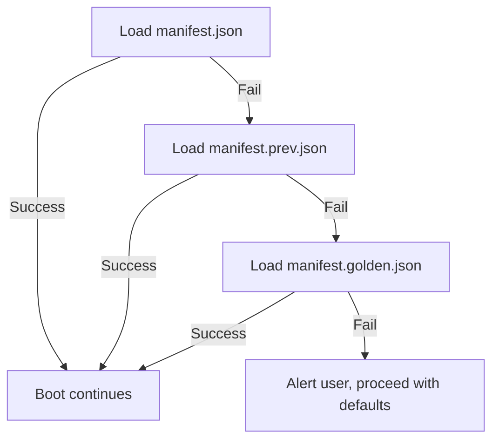

# Configuration System

> ESP32 App Foundation (c) 2026 CB Labs
>
> Walkthrough of the centralized ConfigManager subsystem, configuration persistence model, schema versioning, and migration callbacks.

---

The ESP32 App Foundation implements a centralized configuration model. Individual modules never read or write directly to flash memory. Instead, they implement the [IConfigurable](file:///Users/mcneillm/Documents/Projects/esp32-app-foundation/include/interfaces/IConfigurable.hpp) interface and register with the [ConfigManager](file:///Users/mcneillm/Documents/Projects/esp32-app-foundation/modules/ConfigManager/ConfigManager.hpp), which serves as the centralized gatekeeper for all file I/O operations.

For architectural decisions and structure details, see the [Configuration Architecture](../design_specification.md#8-configuration-architecture) section in the Design Specification.

---

## 1. Config File Ownership Model

All module configuration files are stored on the LittleFS partition. 
- **Storage Location:** Each module receives a dedicated configuration file at `/mod/<namespace>.json` (where `<namespace>` is the unique string returned by `getConfigNamespace()`).
- **File Structure:** The configuration files are stored in JSON format. The framework manages a metadata key `_v` inside the JSON object to track the schema version of the stored data.
- **Access Isolation:** Modules do NOT perform file system operations. ConfigManager is the sole manager of file streams, JSON serialization, and deserialization.

---

## 2. The IConfigurable Interface

Modules participate in configuration persistence by implementing five key methods of the `IConfigurable` interface:

### 1. `getConfigNamespace()`
Returns a unique, lowercase name identifying the module. This namespace dictates the filename on flash (e.g. `/mod/myapp.json`). Must be a compile-time string literal.
```cpp
const char* getConfigNamespace() const override {
    return "myapp";
}
```

### 2. `getSchemaVersion()`
Returns an integer representing the version of the configuration keys. This is used by ConfigManager to detect when the stored config schema is older than the running firmware.
```cpp
int getSchemaVersion() const override {
    return 1;
}
```

### 3. `applyConfig(const JsonObject& section)`
Called at boot (during `ConfigManager::beginAll()`) with the loaded JSON configuration. The module parses keys and applies them to its internal variables.
```cpp
void MyApp::applyConfig(const JsonObject& config) {
    _refreshIntervalMs = config["refreshMs"] | 5000;
    _featureEnabled = config["enabled"] | true;
}
```

> [!TIP]
> The ArduinoJson v7 `|` operator provides a safe fallback value when a key is missing or `null`. Always prefer `config["key"] | defaultValue` over `.as<T>()`, which can crash on missing keys.

### 4. `serializeConfig(JsonObject& section) const`
Called when the framework needs to save the configuration (e.g. after a web portal change). The module writes its variables to the mutable JSON object. ConfigManager handles writing the `_v` field and saving the file to flash.
```cpp
void MyApp::serializeConfig(JsonObject& config) const {
    config["refreshMs"] = _refreshIntervalMs;
    config["enabled"] = _featureEnabled;
}
```

### 5. `resetConfig()`
Called on factory resets or when a file read fails. The module must reset its variables to safe defaults.
```cpp
void MyApp::resetConfig() {
    _refreshIntervalMs = 5000;
    _featureEnabled = true;
}
```

---

## 3. Automatic Registration

When you register your module with the universal registration API `app.registerModule(&yourModule)`, the framework checks if the module inherits from `IConfigurable`. If it does, the framework registers it with the `ConfigManager` automatic registry.

During `app.begin()`, the framework calls `ConfigManager::beginAll()`, which:
1. Iterates through the registered configurable modules.
2. Formats the path `/mod/<namespace>.json`.
3. If the file exists, it reads the content, validates the schema version, applies any migrations, and invokes `applyConfig()`.
4. If the file is missing or corrupted, it calls `resetConfig()` and automatically creates a fresh default config file on flash.

---

## 4. Schema Versioning & Migrations

When firmware updates change the configuration layout (e.g., adding fields, renaming keys), you must bump the integer returned by `getSchemaVersion()`. 

If `ConfigManager` loads a file where the stored version (`_v`) is lower than the value returned by `getSchemaVersion()`, it calls `migrateConfig()`. This allows you to upgrade the stored JSON layout in-place before `applyConfig()` is called.

### The Migration Contract:
```cpp
virtual bool migrateConfig(JsonObject& section, int fromVersion);
```
- **`section`:** A mutable reference to the parsed configuration. You modify it in-place.
- **`fromVersion`:** The version number of the stored config file.
- **Return Value:** Return `true` if migration succeeded. Return `false` to abort the migration, which forces a fallback to factory defaults (calls `resetConfig()`).

### Example Migration Implementation:
```cpp
// In myApp.hpp
int getSchemaVersion() const override { return 2; }
bool migrateConfig(JsonObject& section, int fromVersion) override;

// In myApp.cpp
bool MyApp::migrateConfig(JsonObject& section, int fromVersion) {
    if (fromVersion == 1) {
        // Upgrade from version 1 schema
        // Example: rename 'refreshMs' key to 'interval'
        if (section.containsKey("refreshMs")) {
            int oldVal = section["refreshMs"].as<int>();
            section["interval"] = oldVal;
            section.remove("refreshMs");
        }
        // Add default for new field introduced in version 2
        section["newFeatureEnabled"] = true;
        
        return true;
    }
    return false; // Unknown version - fallback to resetConfig()
}
```

### Framework Example: `TimeManager` Schema v2 (`time` Namespace)

`TimeManager` (`getConfigNamespace() == "time"`, `getSchemaVersion() == 2`) uses this migration contract to introduce DHCP NTP (`dhcpNtp`) and DHCP Timezone (`dhcpTz`) discovery without breaking upgrades from schema v1:

- **`v1` → `v2` migration (`TimeManager::migrateConfig`)**:
  - Seeds `dhcpNtp = true` when missing.
  - Seeds `dhcpTz = !manualTzConfigured` when missing: sets `dhcpTz = false` if the v1 config already specified a non-empty IANA `timezone` or a `posix` string other than `"GMT0"`, preserving explicit manual timezone selections; sets `dhcpTz = true` on unconfigured devices.
- **Zero Flash Wear Invariant**: `TimeManager::serializeConfig()` writes **only** persisted fallback settings (`timezone`, `posix`, `ntpServer1`, `ntpServer2`, `ntpServer3`, `dhcpNtp`, `dhcpTz`) to `/mod/time.json`. Runtime DHCP Option 42/100/101 discoveries (`activeTimezone`, `activePosix`, `dhcpNtpServers`) remain strictly in RAM and never trigger LittleFS writes.

---

## 5. ArduinoJson v7 Best Practices

The framework relies on **ArduinoJson v7**. When reading parameters inside `applyConfig()`, leverage the default operator `|` to provide a fallback value if the key is missing from the JSON document.

### Reading Data (Safe Fallbacks):
```cpp
// Good: If "refreshMs" is missing or null, falls back to 5000
_refreshIntervalMs = config["refreshMs"] | 5000;

// Bad: If "refreshMs" is missing, this results in type-casting issues or crashes
_refreshIntervalMs = config["refreshMs"].as<int>();
```

### Writing Data (Value Assignment):
Write values directly into the mutable `JsonObject` section during serialization:
```cpp
void MyApp::serializeConfig(JsonObject& config) const {
    config["refreshMs"] = _refreshIntervalMs;
    config["enabled"] = _featureEnabled;
}
```

---

## 6. Compile-Time Secrets: FrameworkConfig

The framework distinguishes between persistent runtime configuration and compile-time compilation secrets. 

> [!IMPORTANT]
> **FrameworkConfig vs Configurable Modules:**
> `FrameworkConfig` is a stack-allocated struct passed to `app.begin(config)`. It exists **solely** to carry compile-time secrets (such as the OTA public key, private GitHub token, or repository URL) that must **NOT** be persisted to flash. 
> 
> All other framework and application configurations (WiFi settings, timezone, display brightness, custom parameters) must be handled through the `ConfigManager` + `IConfigurable` persistence model.

The actual `FrameworkConfig` struct contains only OTA-related secrets:

```cpp
struct FrameworkConfig {
    const char* otaPublicKey  = nullptr;  // PEM-encoded RSA public key for OTA verification
    const char* otaGithubRepo = nullptr;  // GitHub "owner/repo" for OTA releases
    const char* otaGithubToken = nullptr; // Optional GitHub token for private repos
};
```

> [!WARNING]
> Do NOT add module-specific settings to `FrameworkConfig`. That struct is reserved for core framework boot-time secrets. Modules manage their own runtime configuration via `IConfigurable`.

---

## 7. Saving Configuration at Runtime

If your module updates its configuration parameters at runtime (for example, in response to a REST API POST request or a display action), you must notify the `ConfigManager` to persist the changes.

To save your settings, pass your module's pointer to `getConfigManager().saveModuleConfig()`:

```cpp
void MyApp::handleConfigChange(int newInterval, bool enabled) {
    _refreshIntervalMs = newInterval;
    _featureEnabled = enabled;

    // Persist changes to /mod/myapp.json
    bool success = app.getConfigManager().saveModuleConfig(this);
    if (!success) {
        ESP_LOGE("MyApp", "Failed to save configuration!");
    }
}
```
`saveModuleConfig()` will dynamically allocate a `JsonDocument`, call your `serializeConfig()` method to populate the fields, append the correct metadata version `_v`, and write the file securely to LittleFS.

> [!WARNING]
> **Flash Wear:** Flash memory has a limited write endurance (~100K cycles per sector). Modules should batch configuration changes where possible and only call `saveModuleConfig()` when a user explicitly alters a setting. Do NOT call it on every `tick()` cycle.

---

## 8. ConfigManifest: Three-Tier Backup

Flash corruption is a serious risk on ESP32 devices, especially if power is lost during a write operation. The framework mitigates this via a three-tier `ConfigManifest` backup rotation.

When the `ConfigManager` writes to disk, it does not simply overwrite `manifest.json`. It follows a safe rotation pattern:

| Tier | File | Purpose |
| :--- | :--- | :--- |
| **Active** | `manifest.json` | Current configuration, loaded during normal boot. |
| **Previous** | `manifest.prev.json` | Snapshot of the prior Active file, taken before each new write. |
| **Golden** | `manifest.golden.json` | Blessed configuration — copied from Active after a successful boot (WiFi connected, tick loop reached without panic). |

### Recovery Sequence

If the `ConfigManager` fails to load the Active manifest (e.g. JSON parse errors, missing file, or corruption):



### Golden Blessing Condition

The Active manifest is promoted to Golden (`manifest.golden.json`) only when the device successfully:
1. Boots and mounts the filesystem.
2. Connects to WiFi in station mode.
3. Reaches the `tick()` loop without panicking.

This ensures the Golden backup always represents a known-good, validated configuration state.

---

## 9. Bulk Export & Import

The `ConfigManager` provides bulk operations for full-device configuration backup and restore:

```cpp
void exportAllConfig(JsonDocument& outDoc);
bool importAllConfig(JsonDocument& inDoc);
```

- **`exportAllConfig()`**: Iterates through all registered `IConfigurable` modules, calling their `serializeConfig()` methods to build a complete JSON tree. Used by the Web Portal to generate a downloadable backup of the device state. Each module's config is nested under its namespace key, with a `_meta` envelope containing device metadata.

- **`importAllConfig()`**: Parses an incoming JSON document, routes the appropriate JSON object to each registered module's `applyConfig()` method, and immediately persists the new state via `saveModuleConfig()`. Unknown top-level keys (e.g. `_meta`) that do not match any registered module namespace are silently skipped.
