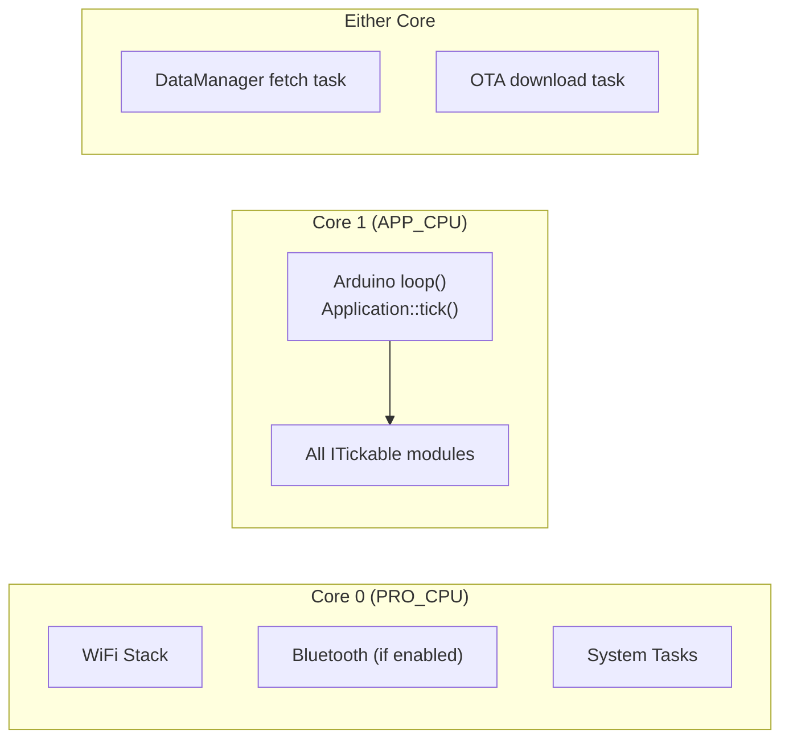

# Embedded Safety

> ESP32 App Foundation (c) 2026 CB Labs
>
> Memory rules, thread safety, power management, and the Design Graveyard — every rejected approach that shaped the framework's architecture.

---

This guide covers the safety constraints that keep an ESP32 application running 24/7 without crashes, memory corruption, or data races. These aren't guidelines — they're hard rules learned from real failures.

**Prerequisites:** Read the [Architecture Overview](architecture-overview.md), [Coding Patterns](coding-patterns.md), and [Performance Guide](performance-guide.md) first.

---

## 1. Memory Rules

The ESP32 has no MMU (Memory Management Unit). There is no virtual memory, no swap space, and no hardware protection against use-after-free or buffer overflows. A single memory corruption bug can silently destabilise the system for hours before finally crashing.

### Rule 1: No Heap Allocation in `tick()`

Code inside an [ITickable::tick()](../../include/interfaces/ITickable.hpp) function executes dozens of times per second. Dynamic allocation in this hot path causes heap fragmentation that accumulates over hours and days.

**Banned operations inside `tick()`:**
- `new` / `malloc` / `calloc`
- `std::vector::push_back()` (unless capacity was pre-reserved)
- Arduino `String` concatenation (`+=`, `+`)
- `DynamicJsonDocument` construction (removed in ArduinoJson 7 — use `JsonDocument`)
- `std::string` construction or concatenation

**Correct pattern — pre-allocate during `begin()`:**

```cpp
class SensorModule : public ITickable {
    // ✅ Pre-allocated at construction — no runtime allocation
    float _temperature = 21.5f;
    char _formatBuffer[128];
    JsonDocument _doc;

    void tick(uint32_t currentMillis) override {
        // Use pre-allocated buffers for all string operations
        snprintf(_formatBuffer, sizeof(_formatBuffer),
                 "Temperature: %.1f°C", _temperature);

        // Use JsonDocument for JSON construction
        _doc.clear();
        _doc["temp"] = _temperature;
    }
};
```

### Rule 2: Static Scope & Allocation (ADR-16)

Core framework modules and application-level managers must be instantiated with **static scope** (global or static variables) rather than dynamically on the heap or stack.

| Allocation Method | Risk on ESP32 | Verdict |
| :--- | :--- | :--- |
| Global / static scope | Memory reserved at compile time, visible in `.bss`/`.data` | ✅ Required |
| Stack-allocated in `setup()` | Goes out of scope — dangling pointer in registry | ❌ Forbidden |
| `new` / heap-allocated | Hides memory consumption until runtime | ⚠️ Avoid for modules |

```cpp
// ✅ Correct: Global scope — outlives tick() loop
Application app;
MyApp myApp;

void setup() {
    app.registerModule(&myApp);
    FrameworkConfig config;
    app.begin(config);
}

// ❌ Fatal: Stack scope — destroyed after setup() returns
void setup() {
    MyApp myApp;  // Destroyed at the closing brace!
    app.registerModule(&myApp);
    app.begin(config);
}
```

> [!CAUTION]
> There is no compiler warning for this. The `registerModule()` call succeeds, `begin()` completes, and the system appears to boot normally — until `tick()` calls a virtual method on a destroyed object, causing a crash minutes or hours later.

### Rule 3: Avoid Arduino `String`

Arduino's `String` class relies on hidden dynamic memory allocation. Concatenation operations (`+=`, `+`) allocate new buffers and free old ones, fragmenting the heap rapidly.

| String Type | Heap Allocation | Recommendation |
| :--- | :--- | :--- |
| Arduino `String` | Every concatenation | ❌ Avoid |
| `std::string` | Dynamic, but more predictable | ⚠️ Acceptable in `begin()`, not in `tick()` |
| `const char*` / `char[]` | None (stack or static) | ✅ Preferred |

```cpp
// ❌ Arduino String — fragments heap
String message = "Sensor ";
message += String(sensorId);   // Two allocations
message += ": ";               // Another allocation
message += String(value, 2);   // Another allocation

// ✅ Fixed-size char buffer — zero heap allocation
char message[64];
snprintf(message, sizeof(message), "Sensor %d: %.2f", sensorId, value);
```

### Rule 4: Bounded `JsonDocument` for POST Body Parsing (ADR-15)

ArduinoJson 7 removed `StaticJsonDocument` and `DynamicJsonDocument`, replacing both with a single elastic `JsonDocument` type.

When parsing incoming Web Portal POST requests or small MQTT payloads, the primary allocation-bounding mechanism is the body-size middleware (`getMaxPostBody()`), which caps the incoming body *before* it reaches the handler. A `JsonDocument` fed a body that is already bounded by the middleware cannot over-allocate.

```cpp
// ✅ ArduinoJson v7 — bounded by getMaxPostBody() middleware
void handlePost(PsychicRequest* request) {
    JsonDocument doc;
    DeserializationError err = deserializeJson(doc, request->body());
    if (err) {
        ESP_LOGE(TAG, "JSON parse failed: %s", err.c_str());
        return;
    }
    const char* name = doc["name"] | "default";
    int value = doc["value"] | 0;
}
```

> [!NOTE]
> As defense-in-depth, you may also pass a max length to the parser (`deserializeJson(doc, body, maxLen)`) or set `DeserializationOption::NestingLimit`.

POST bodies are capped at the contributor's declared `getMaxPostBody()` limit (default: 4096 bytes) by the global middleware in `WebServerManager`, so the parse is bounded by the declared limit rather than by the document type.

### Rule 5: SBO Threshold for `std::function`

The Small Buffer Optimisation (SBO) limit of `std::function` on ESP32 is typically **16 bytes** (2 pointers). If the captured lambda state exceeds this, `std::function` silently performs a heap allocation.

```cpp
// ✅ Within SBO — captures only `this` (8 bytes)
std::function<void()> fn = [this]() { doWork(); };

// ❌ Exceeds SBO — hidden heap allocation
int a, b, c, d, e;
std::function<void()> fn = [this, a, b, c, d, e]() {
    // 8 + 5*4 = 28 bytes captured — exceeds 16 byte SBO threshold
    doWork(a, b, c, d, e);
};
```

This is why the framework's [EventBus](../../modules/EventBus/EventBus.hpp) uses static function pointers with `void*` context instead of `std::function`. See GRAVE-05 in [Section 4: Design Graveyard](#41-stdfunctioneventbus-grave-05).

---

## 2. Thread Safety

The ESP32 is a **dual-core processor**. The App Foundation leverages FreeRTOS tasks for background operations, making thread safety a primary concern.

### FreeRTOS Task Model



| Task | Typical Core | Notes |
| :--- | :--- | :--- |
| `app_main` / Arduino `loop()` | Core 1 (APP_CPU) | All `ITickable::tick()` runs here |
| WiFi stack | Core 0 (PRO_CPU) | System-managed |
| `DataManager` fetch task | Core 0 or unpinned | Separate FreeRTOS task |
| OTA download task | Core 0 or unpinned | Separate FreeRTOS task |

### DataManager Task Context

Network fetches in `DataManager` (implementing [IDataSource](../../include/interfaces/IDataSource.hpp)) execute in a **separate FreeRTOS task**, distinct from the main thread. This means:

- `fetchUpdate()` runs on a different core from `tick()`.
- Data fetched and parsed in the fetch task must be safely transferred to the main thread for rendering.
- Shared state between fetch and tick requires synchronisation.

### `std::atomic` Patterns

For simple flags or numerical values passed between threads, use `std::atomic`. It is significantly faster and less prone to deadlocks than FreeRTOS mutexes for primitive types:

```cpp
#include <atomic>

class WeatherModule : public ITickable, public IDataSource {
    // ✅ Thread-safe primitives — no mutex needed
    std::atomic<float> _temperature{0.0f};
    std::atomic<float> _humidity{0.0f};
    std::atomic<bool> _dataReady{false};

    // Called on DataManager task (Core 0)
    UpdateStatus fetchUpdate() override {
        float temp = parseTemperature(response);
        float hum = parseHumidity(response);

        _temperature.store(temp);  // Atomic write
        _humidity.store(hum);
        _dataReady.store(true);

        return UpdateStatus::Success;
    }

    // Called on main task (Core 1)
    void tick(uint32_t now) override {
        if (_dataReady.load()) {     // Atomic read
            float temp = _temperature.load();
            float hum = _humidity.load();
            updateDisplay(temp, hum);
        }
    }
};
```

> [!WARNING]
> `std::atomic` is safe for individual primitive values. For complex state (multi-field structs, buffers), use a FreeRTOS mutex or a thread-safe queue instead.

### WiFiClientSecure Thread Safety

Due to its massive memory footprint (> 500 bytes for the object, plus internal buffers), `WiFiClientSecure` must **not** be allocated on the stack within a FreeRTOS task. The typical 4 KB – 8 KB task stack will overflow immediately. See [Performance Guide: TLS Memory](performance-guide.md#4-tls-memory) for allocation patterns.

### `Serial.print` Constraints

`Serial.print` and `ESP_LOG` macros are generally thread-safe in ESP-IDF's implementation. However:

- Excessive logging from high-frequency tasks can block the UART and stall other tasks.
- ISR-context logging should be strictly avoided — use `ESP_EARLY_LOG` or `ESP_DRAM_LOG` if absolutely necessary.
- Heavy logging from multiple cores simultaneously can cause interleaved output.

### ISR (Interrupt Service Routine) Constraints

If you implement hardware interrupts (e.g., for a button press or sensor trigger):

| Rule | Reason |
| :--- | :--- |
| Keep the ISR **extremely short** | ISRs block all other interrupts on that core |
| **No blocking functions** | No `vTaskDelay`, no I2C/SPI transactions, no `Serial.print` |
| Use `IRAM_ATTR` | The ISR function must reside in instruction RAM, not flash |
| Use `FromISR` FreeRTOS variants only | e.g., `xQueueSendFromISR()`, `xSemaphoreGiveFromISR()` |

```cpp
// ✅ Correct ISR pattern
volatile bool buttonPressed = false;

void IRAM_ATTR buttonISR() {
    buttonPressed = true;  // Set flag only — no blocking operations
}

// In tick(), check the flag
void MyModule::tick(uint32_t now) {
    if (buttonPressed) {
        buttonPressed = false;
        handleButtonPress();  // Do the real work here, not in the ISR
    }
}
```

---

## 3. Power Management

Optimising power consumption reduces thermal load, extends component lifespan, and is strictly required for battery-operated deployments.

### ESP32 Power Draw Profiles

| Mode | Current Draw (at 3.3V) | Notes |
| :--- | :--- | :--- |
| **Deep Sleep** | ~10 µA – 150 µA | Depends on RTC peripherals enabled |
| **Modem Sleep** (WiFi off, CPU on) | ~20 mA – 30 mA | CPU active, RF off |
| **Active** (WiFi TX/RX) | ~100 mA – 240 mA | Normal operation |
| **AP Mode** (Access Point) | ~100 mA – 120 mA | Must broadcast beacons continuously |

### Display Sleep & Wake Events

The display is often the most power-hungry peripheral. The framework's screensaver controller manages inactivity-based sleep:

- **Inactivity Policy:** Displays should dim or turn off after a configurable timeout.
- **Wake Events:** Modules should publish `system.display.wake` events to the EventBus when user interaction occurs (button press, web portal command, etc.).

```cpp
// Wake the display on user interaction
_eventBus->publish("system.display.wake", nullptr);
```

### Modem Sleep

For devices that only fetch data periodically (e.g., every 5 minutes), keeping WiFi in constant active RX mode wastes power:

- Use ESP-IDF's **automatic modem sleep** features. When enabled, the ESP32 synchronises with the router's DTIM beacon, turning off the RF module between beacons while maintaining the WiFi connection.
- This is transparent to application code — WiFi remains "connected" but the radio sleeps between beacons.

### Light Sleep Considerations

Light sleep suspends the CPU and RF while retaining RAM contents. It is useful for battery operation but has important limitations:

| Consideration | Impact |
| :--- | :--- |
| FreeRTOS tick count | **Stops or jumps** during sleep — `ITickable` timing breaks |
| Peripherals (I2C/SPI) | Must be de-initialised before sleep and re-initialised on wake |
| Wake sources | GPIO, timer, or UART can trigger wake |
| WiFi connection | **Lost** — must reconnect after wake |

> [!IMPORTANT]
> Applications using light sleep must carefully manage peripheral state and cannot rely on standard `ITickable` timing assumptions. The `currentMillis` parameter will show a gap corresponding to the sleep duration.

---

## 4. Rejected Approaches (Design Graveyard)

The framework's architecture is shaped by past failures. These 10 designs were proposed, tested, and explicitly rejected. Each entry documents what was proposed, why it failed, and what we do instead. Do not attempt to re-implement any of them.

### 4.1. `std::function` EventBus (GRAVE-05)

**What was proposed:** Use `std::function<void(const char*, void*)>` for EventBus callbacks, allowing lambdas with captured state to be passed directly.

**Why it was rejected:** The ESP32's Small Buffer Optimisation (SBO) threshold is ~16 bytes. Any lambda capturing more than a single pointer exceeds this limit, forcing `std::function` to perform a hidden **heap allocation**. In a 24/7 system processing hundreds of events per second, these micro-allocations create catastrophic heap fragmentation, eventually causing OOM.

**What we do instead:** The [EventBus](../../modules/EventBus/EventBus.hpp) uses static function pointers with an explicit `void*` context parameter. Zero heap allocations, deterministic memory usage:

```cpp
// Static function pointer — guaranteed zero allocation
static void onEvent(const char* topic, void* data, void* context) {
    auto* self = static_cast<MyModule*>(context);
    self->handleEvent(data);
}
bus.subscribe("topic", onEvent, this);
```

---

### 4.2. Unified `IDisplayDriver` (ADR-02)

**What was proposed:** A single abstract interface (`IDisplayDriver`) that could wrap U8G2 (monochrome OLED), TFT_eSPI (colour TFT), and e-ink display libraries behind one universal API.

**Why it was rejected:** Each display technology requires a radically different rendering paradigm. E-ink needs damage-rect partial refresh to avoid ghosting. TFT supports 16-bit colour and high frame rates. OLED uses 1-bit buffers with full-screen refresh. The lowest-common-denominator API would strip away the unique capabilities of each technology, producing a leaky abstraction that satisfies no one.

**What we do instead:** Use the concrete driver directly. The framework defines [IDisplayBoard](../../modules/U8G2Display/IDisplayBoard.hpp) as the abstraction for *content rendering* (which is display-agnostic), while the display *driver* remains concrete. If swapping display hardware, replace the entire Display Module rather than abstracting the driver.

---

### 4.3. Dynamic Board Factory

**What was proposed:** Instantiate [IDisplayBoard](../../modules/U8G2Display/IDisplayBoard.hpp) objects on-the-fly when their display time arrives in the carousel rotation.

**Why it was rejected:** Violates the "No Heap in Tick" rule. Creating objects with `new` during the display carousel's tick loop causes unpredictable latency spikes and OOM crashes. On a device running 24/7, any allocation that isn't eventually freed is a memory leak.

**What we do instead:** All display boards are instantiated at boot with static scope and registered with the carousel engine during `begin()`. The carousel rotates through pre-existing board pointers — no runtime allocation.

---

### 4.4. Buffered OTA

**What was proposed:** Download the entire OTA firmware payload to LittleFS before flashing, allowing checksum verification of the complete binary before committing.

**Why it was rejected:** The ESP32's flash is too small. A 2 MB firmware plus a 2 MB temporary buffer would require 4 MB just for OTA staging, leaving no room for app partitions, LittleFS, or web assets. On a 4 MB flash chip, this is physically impossible.

**What we do instead:** Streaming decryption directly to the OTA partition (ADR-13). The [IOTAVerifier](../../include/interfaces/IOTAVerifier.hpp) interface accumulates a SHA-256 hash incrementally via `update(const uint8_t* data, size_t length)` as chunks arrive, then verifies the final digest against a detached signature via `verify(const uint8_t* signature, size_t signatureLength)`. No intermediate storage is needed.

---

### 4.5. Monolithic Config

**What was proposed:** A single JSON document or C++ struct representing the entire application's configuration state — WiFi settings, display preferences, API keys, sensor calibration, all in one file.

**Why it was rejected:** Creates impossible merge conflicts between unrelated modules. Violates SRP (every module change modifies the central config) and OCP (adding a module requires changing the config structure). Serialising a massive document requires a large contiguous memory allocation.

**What we do instead:** The [ConfigManager](../../modules/ConfigManager/ConfigManager.hpp) routes persistence, but each module owns its own config structure via [IConfigurable](../../include/interfaces/IConfigurable.hpp). Config files are stored at `/mod/<namespace>.json` — each module serialises and deserialises independently. See [Config System](config-system.md).

---

### 4.6. MessagePool as IPC

**What was proposed:** A complex object-pool system for passing structured messages between FreeRTOS tasks (inter-process communication), similar to a message broker.

**Why it was rejected:** Massively over-engineered for the ESP32's needs. The pool required its own memory management, reference counting, and type-safe casting — all of which added complexity and heap overhead.

**What we do instead:** `std::atomic` for primitive shared state (see [Section 2](#2-thread-safety)) and simple FreeRTOS queues (`xQueueSend` / `xQueueReceive`) for structured data transfer between tasks. Both provide the necessary synchronisation with drastically lower overhead.

---

### 4.7. LittleFS-Only Portal

**What was proposed:** Serve all Web Portal HTML, JavaScript, and CSS directly from LittleFS files, with no compiled-in fallbacks.

**Why it was rejected:** If LittleFS corrupts (bad flash sector, power loss during write, accidental format), the device has **no way to present a configuration UI** to the user. The device becomes a brick that can only be recovered via USB serial flashing.

**What we do instead:** The core portal UI is compiled into the firmware as fallback constants. LittleFS serves customised assets when available, but the essential configuration pages (WiFi setup, system status) work even if the filesystem is empty or corrupted.

---

### 4.8. String-Based Topic Matching

**What was proposed:** MQTT-style wildcard matching (`topic/*`, `+/sensor/#`) for the EventBus, allowing subscribers to match patterns instead of exact strings.

**Why it was rejected:** String pattern matching with wildcards requires iterating through all subscriptions and performing substring comparisons — far too computationally expensive for the tick loop, which processes events dozens of times per second. On the ESP32, every microsecond in the tick loop matters.

**What we do instead:** Exact string matching for EventBus topics. Topics are short, descriptive strings (e.g., `system.heap`, `app.running`). If you need broader event handling, subscribe to individual topics explicitly.

---

### 4.9. Heavy Hub Orchestrator

**What was proposed:** A central "Hub" module that polls sensors, queries data sources, and pushes results to the display — a single coordinator managing all data flow.

**Why it was rejected:** The textbook [Orchestrator Anti-Pattern](coding-patterns.md#4-service-module-pattern-smp). Creates a God Object with knowledge of every module's internal state. Every new feature requires modifying the hub. Testing any component in isolation becomes impossible because everything depends on the hub.

**What we do instead:** Modules observe the EventBus and use dependency injection. Each module is a self-contained service that publishes events and reacts to events. The `Application` class provides lifecycle orchestration (boot, config, tick) but never touches business logic. See [Service Module Pattern](coding-patterns.md#4-service-module-pattern-smp).

---

### 4.10. `delay()` in Initialisation

**What was proposed:** Using `delay(500)` during `begin()` to wait for hardware sensors to settle, I2C buses to stabilise, or peripherals to power up.

**Why it was rejected:** `delay()` blocks the **entire core** — not just your module, but all framework initialisation, the web portal startup, WiFi processing, and every other module's boot sequence. The device appears dead to the user during the delay, with no status indication on the display or web portal.

**What we do instead:** Initialisation should be non-blocking. If hardware genuinely requires settling time:

1. **Set a flag** during `begin()` and handle the wait in early `tick()` calls using the standard `currentMillis` comparison pattern.
2. **Use `vTaskDelay()`** inside a dedicated FreeRTOS background task (not the main loop) if blocking is unavoidable.
3. **Never** use `delay()` on the main core.

```cpp
// ❌ Blocks the entire core for 500ms
void MySensor::begin() {
    initHardware();
    delay(500);  // Everything stops!
    readCalibration();
}

// ✅ Non-blocking settling in tick()
void MySensor::begin() {
    initHardware();
    _settlingUntilMs = millis() + 500;
}

void MySensor::tick(uint32_t now) {
    if (now < _settlingUntilMs) return;  // Still settling
    if (!_calibrated) {
        readCalibration();
        _calibrated = true;
    }
    // Normal tick logic
}
```

---

## See Also

- [Architecture Overview](architecture-overview.md) — System design and lifecycle
- [Coding Patterns](coding-patterns.md) — Modules vs Libraries, SOLID, anti-patterns
- [Performance Guide](performance-guide.md) — RAM budgeting, heap management, profiling
- [Creating a Module](creating-a-module.md) — Step-by-step module tutorial
- [Event Bus](event-bus.md) — Publish-subscribe communication
- [Scheduling Data Fetches](scheduling-data-fetches.md) — Background data fetching with `IDataSource`
