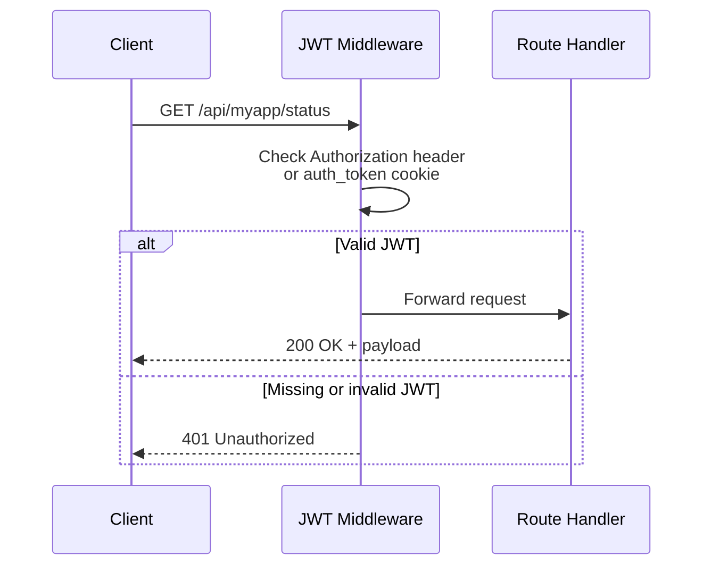

# Extending the Web Portal

> ESP32 App Foundation (c) 2026 CB Labs
>
> Tutorial on adding custom bottom-nav tabs, HTML/JS fragments, and REST API endpoints to the framework's SPA web portal.

---

The ESP32 App Foundation features a local Single Page Application (SPA) web portal hosted on the device. Downstream developers can extend the portal nav bar with custom tabs and register REST API endpoints by implementing the [IWebContributor](file:///Users/mcneillm/Documents/Projects/esp32-app-foundation/include/interfaces/IWebContributor.hpp) interface.

For a detailed blueprint, see the [Web Portal Architecture](../design_specification.md#10-web-portal-architecture) section in the Design Specification.

---

## 1. The IWebContributor Interface

To add a tab or expose web routes, your module must inherit from `IWebContributor` and implement its virtual functions.

### Interface Method Walkthrough:

#### `registerRoutes(PsychicHttpServer& server)`
Called during the boot phase (`WebServerManager::begin()`). This is where you register HTTP route handers (GET, POST, etc.) and bind them to C++ lambda functions.
```cpp
void registerRoutes(PsychicHttpServer& server) override;
```

#### `getTabName()`
Returns the user-facing display label for the tab (e.g., "MyApp"). If a module only needs to register REST API routes but does not require a frontend tab, return `nullptr` (default).
```cpp
const char* getTabName() const override { return "MyApp"; }
```

#### `getParentTab()`
Returns the name of a parent tab to create hierarchical sub-navigation.
- Return `nullptr` (default) to render the tab as a top-level item in the main bottom navigation bar.
- Return `"System"` to nest the tab under the system sub-navigation (rendered as pills in the System pane).
```cpp
const char* getParentTab() const override { return nullptr; } // Renders in bottom-nav
```

#### `getTabOrder()`
Returns an integer that controls the rendering order relative to other tabs at the same level. Lower values are positioned first. Default is `100`.
```cpp
int getTabOrder() const override { return 100; }
```

#### `getTabIcon()`
Returns the SVG path body (inner content of the `<svg>` block) to use as the nav icon. If you return `nullptr` (default), the web portal automatically displays a generic grid icon.
```cpp
const char* getTabIcon() const override {
    // Example: simple checkmark icon path
    return "<path d='M9 16.17L4.83 12l-1.42 1.41L9 19 21 7l-1.41-1.41z'/>";
}
```

---

## 2. End-to-End Pattern: C++ to DOM

The portal is a Single Page Application. It does **not** load HTML fragments from the filesystem. Instead, at boot `app.js` fetches the tab hierarchy from `/api/tabs`, and for each tab it loads that tab's **JavaScript** over the HTTP route the module registered (declared via `getTabScript()`). When the user activates a tab, that script builds its own DOM markup into the tab's container and talks to the REST endpoints your module registered in C++. There is no separate per-tab HTML file.

### C++ Web API Routes (Backend)
Here is the route registration from the template file [myApp.cpp](../../template-app/src/myApp.cpp). It registers a GET route to retrieve status, and a POST route to update settings:

```cpp
#ifndef NATIVE_BUILD
void MyApp::registerRoutes(PsychicHttpServer& server) {
    // --- GET Endpoint: Retrieve Status ---
    server.on("/api/myapp/status", HTTP_GET, [this](PsychicRequest* request, PsychicResponse* response) {
        JsonDocument doc;
        doc["status"] = "ok";
        doc["refreshMs"] = _refreshIntervalMs;
        doc["enabled"] = _featureEnabled;
        doc["gateOpen"] = _gateOpen;

        String output;
        serializeJson(doc, output);
        return response->send(200, "application/json", output.c_str());
    });

    // --- POST Endpoint: Save Configuration ---
    server.on("/api/myapp/config", HTTP_POST, [this](PsychicRequest* request, PsychicResponse* response) {
        const char* body = request->bodyCStr();
        if (!body || strlen(body) == 0) {
            return response->send(400, "application/json", "{\"error\":\"body_required\"}");
        }

        JsonDocument doc;
        DeserializationError error = deserializeJson(doc, body);
        if (error) {
            return response->send(400, "application/json", "{\"error\":\"Invalid JSON\"}");
        }

        // Apply new settings
        if (doc["refreshMs"].is<int>()) {
            _refreshIntervalMs = doc["refreshMs"].as<int>();
        }
        if (doc["enabled"].is<bool>()) {
            _featureEnabled = doc["enabled"].as<bool>();
        }

        // Persist config to LittleFS
        app.getConfigManager().saveModuleConfig(this);

        return response->send(200, "application/json", "{\"status\":\"saved\"}");
    });
}
#endif
```

---

## 3. Authoring Your Tab's Markup

Your tab has **no separate HTML file**. Its markup is a string your tab script injects into its container (via `container.innerHTML = ...`) the first time the tab is activated — see the IIFE pattern in §4. This section describes what that injected markup should look like.

### The markup your script injects
Build an HTML snippet representing your tab UI and assign it to the container's `innerHTML`. It should contain only the body components, not wrapping `<html>` or `<body>` elements.

> [!IMPORTANT]
> **HTML ID Scoping Rule:** All element IDs must be prefixed with your module name to avoid collisions with other tabs loaded into the same SPA DOM. Use `id="myapp-save-btn"` — never `id="save-btn"`. Multiple tabs coexist in a single HTML document, so unprefixed IDs will clash.

> [!TIP]
> **Canonical Containers:** For structural card containers, use the `.card` class (e.g., `<div class="card">`). The legacy `<article>` tag is still supported for backward compatibility but `.card` is the modern standard.

> [!TIP]
> **Alerts:** Use the `.alert` component for inline feedback (e.g., `<div class="alert alert--info" role="status">Message</div>`). Modifiers include `--success`, `--error`, `--warning`, and `--info`.

```html
<!-- MyApp tab content fragment -->
<div class="tab-content" id="myapp-tab">
    <h2>My Application</h2>
    <div class="card">
        <h3>Status</h3>
        <div id="myapp-status">Loading...</div>
    </div>
    <div class="card">
        <h3>Configuration</h3>
        <label>
            Refresh Interval (ms):
            <input type="number" id="myapp-refresh-ms" value="5000" min="1000" max="60000">
        </label>
        <label>
            <input type="checkbox" id="myapp-enabled" checked>
            Feature Enabled
        </label>
        <button id="myapp-save-btn">Save</button>
    </div>
</div>
```

---

## 3.1 CSS Component Reference

The portal design system (`app.css`) provides standard component classes following BEM naming conventions. All components ship with their accessibility contracts defined.

### Card Container (`.card`)
Structural container for tab content sections.
```html
<div class="card">
    <h3>Section Title</h3>
    <p>Card content goes here.</p>
</div>
```

### Disabled Section State (`[aria-disabled="true"]`)
Disables interactive cards or sections (e.g., feature-gated via `IConfigGate`). Applies 50% opacity, `pointer-events: none`, and subtle grayscale filter.
```html
<div class="card" aria-disabled="true">
    <h3>Gated Feature</h3>
    <p>This module is disabled.</p>
</div>
```
- **A11y:** Set `aria-disabled="true"` on the element to communicate the disabled state to screen readers.

### Loading Button State (`button[aria-busy="true"]`)
Displays a spinning loading indicator inside the button and disables pointer events.
```html
<button id="save-btn" aria-busy="true">Saving...</button>
```
- **A11y:** Set `aria-busy="true"` dynamically during async operations to announce loading state to screen readers.

### Instruction Callout (`.callout`)
Accent-bordered callout box for supplementary guidance and information.
```html
<aside class="callout" role="note">
    <p>Note: Changing this setting requires an AP mode reconnect.</p>
</aside>
```
- **A11y:** Use `<aside>` or add `role="note"` when containing supplementary guidance.

### Terminal Log Viewer (`.terminal-log`)
Green-on-black monospace console for live log streams.
```html
<div id="sys-log" class="terminal-log" role="log" aria-live="polite">
    <div class="terminal-log__line">[INFO] System initialized</div>
</div>
```
- **A11y:** Container MUST include `role="log"` and `aria-live="polite"` for live log updates. Managed automatically by `window.renderTerminalLog()`.

### Dialog Close Button (`.dialog-close-btn`)
Top-right close button for modal dialogs.
```html
<dialog id="settings-dialog">
    <button class="dialog-close-btn" aria-label="Close" onclick="this.closest('dialog').close()">&times;</button>
    <div class="card">Dialog Content</div>
</dialog>
```
- **A11y:** Must include `aria-label="Close"` for screen reader accessibility.

### Password Mask Placeholder (`.password-mask`)
Spaced dots placeholder styling for saved password inputs.
```html
<input type="password" class="password-mask" placeholder="••••••••" value="">
```

### Field Validation Feedback (`.field-feedback`)
Validation feedback message displayed below input controls. Modifiers: `.field-feedback--error`, `.field-feedback--success`.
```html
<label for="wifi-ssid">SSID</label>
<input type="text" id="wifi-ssid" aria-describedby="ssid-feedback">
<small id="ssid-feedback" class="field-feedback field-feedback--error">SSID is required.</small>
```
- **A11y:** Input element MUST link to the feedback element via `aria-describedby="<id>"`.

### Card Modifiers & Grid System (`.card--interactive`, `.card--empty`, `.card-grid`, `.card-grid--2col`)
Grid layout and modifier variants for card containers.
```html
<!-- Interactive Card Grid (2-column on desktop, 1-column on mobile <400px) -->
<div class="card-grid card-grid--2col">
    <div class="card card--interactive" role="button" tabindex="0">
        <h3>Device Status</h3>
        <p>Click to inspect telemetry.</p>
    </div>
    <div class="card card--empty" role="button" aria-label="Add new item" tabindex="0">
        <p>+ Add New Sensor</p>
    </div>
</div>
```
- **A11y:** Interactive cards MUST use `role="button"` or be wrapped in `<a>`/`<button>` elements with keyboard accessibility (`tabindex="0"` if non-button). Empty state cards acting as "add new" MUST include `aria-label="Add new item"`.

### Status Dot Sizing (`--dot-size`)
Customizable status dot indicator. Size can be overridden contextually via CSS custom property `--dot-size`.
```html
<!-- Default 10px dot -->
<span class="dot dot--green"></span>

<!-- Small 8px dot inside a container -->
<div style="--dot-size: 8px;">
    <span class="dot dot--yellow"></span>
</div>
```

### Subtle Badge Modifier (`.badge--subtle`)
Subtle tinted background badge for minor tags and status metadata.
```html
<span class="badge badge--subtle">Experimental</span>
```

### Info Row vs Compact Row (`.info-row` vs `.compact-row`)
Row containers are semantically distinct based on data display vs input interactions:
- **`.info-row`** — Read-only key-value data display (label left, value right, bottom divider).
- **`.compact-row`** — Interactive input and button pair (label + input left, button right).
- *Note:* If a third variant for clickable list items is needed (e.g. WiFi scan results), use `.card--interactive` inside a `.card-grid`.
```html
<!-- Read-only data display -->
<div class="info-row">
    <span>IP Address</span>
    <span class="text-muted">192.168.1.100</span>
</div>

<!-- Interactive input + action pair -->
<div class="compact-row">
    <label>
        API Key
        <input type="text" id="api-key">
    </label>
    <button id="apply-key-btn">Apply</button>
</div>
```

---

## 4. The Tab Script Pattern

> [!IMPORTANT]
> **Delivering a tab script (canonical): the gzip+PROGMEM pipeline.**
> A tab's JavaScript is served over an HTTP route your module registers in
> `registerRoutes()`. The **canonical** way to deliver it — for framework
> modules *and consuming apps* — is the framework's gzip+PROGMEM asset pipeline,
> the same one used for `app.js` and friends:
>
> 1. Put the script in a `web/` directory: `modules/<Name>/web/<name>.js` for a
>    framework module, or **`<yourProject>/web/<name>.js`** for a consuming app.
>    The build script scans the consuming project's `web/` dir automatically.
> 2. `scripts/portalBuilder.py` gzip-compresses it at build time into
>    `portal_assets/<name>_js.hpp`, exposing `<name>_js_gz` / `<name>_js_gz_len` /
>    `<name>_js_gz_etag`. **Framework** assets land in `<framework>/include/`;
>    **consumer** assets land in `<yourProject>/include/` — add `-I include` to
>    your `build_flags` so the header resolves.
> 3. Serve it with the shared helper (pass the request for conditional GET, plus
>    the `_gz`/`_gz_len`/`_gz_etag` triple):
>    ```cpp
>    #include "web/serveGzipAsset.hpp"
>    #include "portal_assets/weather_js.hpp"
>    // in registerRoutes():
>    server.on("/weather.js", HTTP_GET, [](PsychicRequest* request, PsychicResponse* response) {
>        return serveGzipAsset(request, response,
>                              weather_js_gz, weather_js_gz_len, weather_js_gz_etag,
>                              "application/javascript");
>    });
>    ```
>    The helper also sends an ETag + `Cache-Control: no-cache` and answers a
>    matching `If-None-Match` with a `304`, so browsers revalidate cheaply and
>    only re-download when the asset actually changes (e.g. after an OTA).
> 4. Declare the route via `const char* getTabScript() const override { return "/weather.js"; }`.
>
> **Why this matters:** `response->send(body)` copies the entire body into
> internal DRAM socket buffers. For a non-trivial script (18 KB is routine) this
> can drop free heap to near-OOM and cause multi-second serves / `0 bytes
> received` browser timeouts (issue #111). The gzip pipeline serves straight from
> flash — zero DRAM impact. Only for a *tiny* inline fragment (< ~1 KB) is a raw
> C++ string literal (`response->send(200, "application/javascript", js)`)
> acceptable. The reference implementation is the sample app's `WeatherModule`
> (`sample-app/web/weather.js` + `serveGzipAsset`).
>
> The DOM/authoring conventions below (the IIFE pattern, `tab-changed`, ID
> scoping) apply to your script regardless of how it is delivered.

Immediately after the shell loads your script, it executes it and — on tab
activation — the script renders its own markup into its container.

### The `tab.js` IIFE Pattern

Because all tab scripts execute in the same global `window` scope, variable names from one tab can collide with another. To prevent this namespace pollution, **all tab JavaScript MUST be wrapped in an Immediately Invoked Function Expression (IIFE)**:

```javascript
(function() {
    'use strict';
    // All tab logic lives inside this closure.
    // Variables declared here are NOT visible to other tabs.
})();
```

> [!WARNING]
> If you omit the IIFE wrapper, any `const`, `let`, or `function` declarations at the top level will collide with identically-named symbols from other tabs, causing hard-to-debug runtime errors.

### The tab script (served from your `web/<name>.js`)
Wire up event listeners and fetch data from your API endpoints:

```javascript
(function() {
    'use strict';

    const statusEl = document.getElementById('myapp-status');
    const refreshInput = document.getElementById('myapp-refresh-ms');
    const enabledInput = document.getElementById('myapp-enabled');
    const saveBtn = document.getElementById('myapp-save-btn');

    // Fetch current status from the C++ REST endpoint
    async function loadStatus() {
        try {
            const response = await fetch('/api/myapp/status');
            if (!response.ok) throw new Error('Failed to fetch status');
            const data = await response.json();
            
            // Render data to DOM
            statusEl.textContent = JSON.stringify(data, null, 2);
            
            // Pre-populate input fields
            refreshInput.value = data.refreshMs;
            enabledInput.checked = data.enabled;
        } catch (err) {
            statusEl.textContent = 'Error: ' + err.message;
        }
    }

    // Post new settings back to the C++ REST endpoint
    async function saveConfig() {
        const refreshMs = refreshInput.value;
        const enabled = enabledInput.checked;
        
        try {
            const response = await fetch('/api/myapp/config', {
                method: 'POST',
                headers: { 'Content-Type': 'application/json' },
                body: JSON.stringify({ refreshMs: parseInt(refreshMs), enabled })
            });
            if (!response.ok) throw new Error('Failed to save config');
            
            window.showToast('Configuration saved.', 'success');
            loadStatus(); // Reload values
        } catch (err) {
            window.showToast('Save failed: ' + err.message, 'error');
        }
    }

    // Wire up event listeners
    saveBtn?.addEventListener('click', saveConfig);

    // Initial load
    loadStatus();
})();
```

---

## 5. API Route Conventions

- **Path Naming:** All API paths must start with `/api/` followed by your module's namespace: `/api/<namespace>/<endpoint>`.
- **Method Usage:**
  - `HTTP_GET` for queries (e.g., retrieving status or reading variables).
  - `HTTP_POST` for triggering actions or saving configurations.
- **Payload Format:** Request and response payloads must utilize the `application/json` mime type.
- **Resource Constraints:** Always parse JSON bodies safely. If payload size is large, verify memory heap space prior to allocations to avoid low-memory conditions.

---

## 6. Save & Reboot Policy

When adding settings to your tab, follow the framework's standard save policy to ensure UX consistency across all portal tabs.

### The Four Tiers

| Tier | Name | When to Use | UI Pattern |
|------|------|-------------|------------|
| **Instant** | Single-field settings that take effect immediately (no reboot) | Auto-save on each change + `showToast()` feedback |
| **Batched** | Multiple related fields that should be committed atomically | Explicit "Save" button + `showToast()` feedback |
| **Disruptive** | Settings that require a device reboot to take effect | Auto-save or button + `showRebootOverlay()` |
| **Destructive** | Irreversible actions (reset, delete, erase) | `armButton()` or typed confirmation + `showRebootOverlay()` |

> [!IMPORTANT]
> **Every save must produce user feedback.** A silent save (no toast, no overlay) is a policy violation. Use `window.showToast()` for transient feedback and `window.showRebootOverlay()` for reboot paths.

### Shared Utility Functions

The framework provides these global functions in `utils.js` (loaded before all tab scripts):

- **`window.showToast(message, type, duration)`** — Slide-in toast notification. Types: `'success'`, `'error'`, `'warning'`, `'info'`.
- **`window.armButton(button, action, timeout)`** — Armed confirmation pattern. First click arms the button, second click within timeout executes the action.
- **`window.showRebootOverlay(message, subMessage)`** — Full-screen overlay with spinner and reconnection polling. Auto-reloads the page when the device comes back online.
- **`window.apiFetch(url, options)`** — Serialised fetch wrapper. **Always use this instead of raw `fetch()`** — it queues requests to protect ESP32 socket pools.
- **`window.apiFetch.enqueueTask(taskFn, delayMs)`** — Enqueue a background task in the low-priority lane, preventing it from blocking UI API requests.
- **`window.renderTerminalLog(containerId)`** — Initialize a terminal log viewer inside a container element (`role="log"`, `aria-live="polite"`). Returns `{ append(line), clear(), scrollToBottom() }`.
- **`window.renderSignalBars(rssi)`** — Generates an inline SVG signal strength icon (0–4 bars) wrapped in a `<span class="signal-bars" aria-label="Signal: N of 4 bars">` container.

### Decision Rule

> Auto-save is the default. Only use an explicit "Save" button when the user is editing **multiple related fields** that should be committed atomically.

---

## 7. POST Safety (ADR-15)

Handling POST requests on the ESP32 requires strict safety constraints due to RAM limitations. **ADR-15** governs all incoming POST body handling.

### 4096-Byte Body Cap

The framework enforces a hard limit of **4096 bytes** on incoming POST bodies. The `PsychicHttp` server rejects larger payloads before the route handler is invoked. This protects against memory exhaustion from malicious or oversized requests.

### Mandatory Stack-Allocated JSON Parsing

When parsing JSON from a POST body, you **MUST** use `JsonDocument` with a size-capped input. **Never** allocate unbounded JSON buffers for incoming request parsing — concurrent requests will fragment the heap and cause panics.

```cpp
server.on("/api/myapp/config", HTTP_POST, [this](PsychicRequest* request, PsychicResponse* response) {
    const char* body = request->bodyCStr();
    if (!body || strlen(body) == 0) {
        return response->send(400, "application/json", "{\"error\":\"body_required\"}");
    }

    // ADR-15: MUST use JsonDocument with capped input
    JsonDocument doc;
    DeserializationError error = deserializeJson(doc, body);
    if (error) {
        return response->send(400, "application/json", "{\"error\":\"Invalid JSON\"}");
    }

    // Process parsed data...
    return response->send(200, "application/json", "{\"status\":\"saved\"}");
});
```

> [!WARNING]
> In ArduinoJson v7, `StaticJsonDocument` and `DynamicJsonDocument` are removed — use `JsonDocument` instead. Keep POST bodies within the 4096-byte cap enforced by PsychicHttp to bound memory usage under concurrent load.

---

## 8. The Tab Registry Contract: `/api/tabs`

The main web page generates the navigation interface by querying `/api/tabs` on load. 

The `WebServerManager` builds this registry dynamically at boot by querying all registered `IWebContributor` pointers. It returns a JSON array of configuration objects.

### JSON Schema Response:
```json
[
  {
    "name": "Status",
    "id": "Status",
    "parent": "System",
    "order": 10
  },
  {
    "name": "MyApp",
    "id": "MyApp",
    "order": 100,
    "icon": "<path d='M9 16.17L4.83 12l-1.42 1.41L9 19 21 7l-1.41-1.41z'/>"
  }
]
```

### Nav Resolution logic:
When the client SPA sees this array, it:
1. Sorts all entries based on the `order` key.
2. Group tabs with a `parent` key under the respective parent dropdown/view (e.g., nesting "Status" as a sub-pill under the "System" tab).
3. Renders top-level entries (no `parent` field) in the bottom-nav bar.
4. Loads each tab's script (the `script` field, e.g. `/weather.js`) over HTTP and binds click handlers that dispatch the `tab-changed` event so the loaded script renders its container.

---

## 9. Authentication & Security

The framework's web portal uses JSON Web Tokens (JWT) for API endpoint security. When the `AuthManager` is enabled, downstream modules get authentication enforcement for free — no per-route auth code is required.

### AuthManager

The [AuthManager](../../modules/WebServerManager/AuthManager.hpp) is a core framework service responsible for:
1. Validating user credentials (defined via `FrameworkConfig` or stored in a secure partition)
2. Generating JWT tokens upon successful login
3. Validating incoming JWT tokens on subsequent API requests

### JWT Middleware Flow

The `WebServerManager` attaches an authentication middleware to the `PsychicHttpServer` instance. This middleware intercepts **all** requests to `/api/*` paths.



When a request arrives, the middleware performs a **dual-check**:
1. Looks for an `Authorization: Bearer <token>` HTTP header
2. Falls back to checking for an `auth_token` cookie

If either provides a valid, non-expired JWT, the request proceeds to the module's route handler. If both are missing or invalid, the middleware immediately returns `401 Unauthorized` — the route handler is never invoked.

### Public Path Bypass

Certain routes must be accessible without authentication. The middleware maintains a bypass list:

| Path Pattern | Reason |
|:---|:---|
| `/api/auth/login` | Client must be able to submit credentials to obtain a JWT |
| `/api/tabs` | Tab registry must load before authentication to render the login page |
| Non-`/api/` paths | Static assets (`.html`, `.css`, `.js`, images) are served without auth |

### What Downstream Developers Need to Know

> [!IMPORTANT]
> You do **NOT** need to write authentication verification code inside individual route handlers. All `/api/` routes are automatically protected by the global JWT middleware. Simply register your routes via `registerRoutes()` and the framework handles security.

The SPA client is responsible for intercepting `401` responses from the API, destroying the local token, and redirecting the user to the login screen.

---

## 10. Web Server Stack & Configuration Tuning

`WebServerManager` manages HTTP (port 80) and HTTPS (port 443) server tasks.

### Default Sizing & Board Contract

Default task stack size and max open sockets are defined in `board_contract.h`:
- `BOARD_HTTP_STACK_SIZE`: 8192 bytes (8 KB)
- `BOARD_HTTP_MAX_OPEN_SOCKETS`: 4 (browser 2-3 + MCP 1; boards with more DRAM can override upward)

Because deep call stack operations (such as screenshot PNG compression) are offloaded to `DeepStackExecutor` in PSRAM, the HTTP server task stack runs safely at 8 KB without risk of stack overflow.

### Modern `setHttpConfig()` API

If your application requires custom HTTP task stack size or socket limits, call `setHttpConfig()` before starting the web server (`begin()`):

```cpp
// Custom HTTP server configuration
app.getWebServerManager().setHttpConfig(8192, 7);
```

> [!NOTE]
> **Retiring Legacy Overrides**: Manual manipulation of `getServer().config.stack_size` or `max_open_sockets` is **retired**. Use `setHttpConfig()` or `board.h` macros instead.
>
> **Flash Safety Rule**: The HTTP task stack MUST remain in internal DRAM (`MALLOC_CAP_INTERNAL`). Do not place the HTTP server task stack in PSRAM, as direct-upload OTA writes execute on the HTTP task thread with the SPI flash cache disabled.

