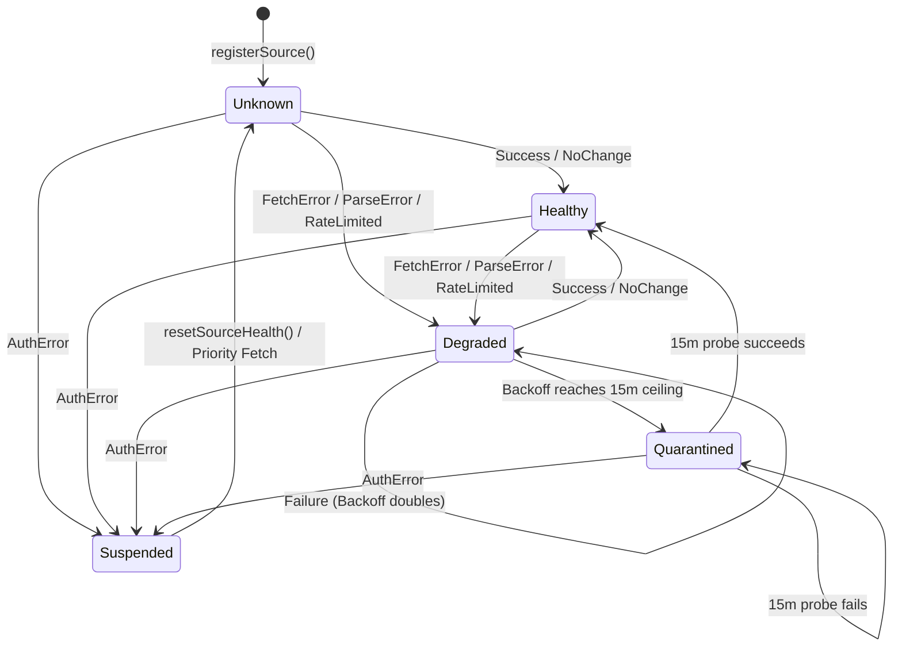

# FetchContext & Data Fetch Contract

> ESP32 App Foundation (c) 2026 CB Labs
>
> Learn about the `FetchContext` transport contract, `DeadlineToken` cooperative deadlines, framework-owned TLS clients, and the data source resilience architecture.

---

## 1. Overview & Core Philosophy

In embedded IoT applications, remote data sources (HTTP REST APIs, weather feeds, cloud MQTT brokers) are inherently unpredictable. High network latency, dropped packets, server rate limits, DNS resolution stalls, or expired credentials can delay network operations.

Prior to Issue #128, a stalled HTTP request or slow TLS handshake could exceed the ESP32 Task Watchdog Timer (TWDT) timeout (5 seconds), causing an unconditional hardware reboot. 

The framework's data-fetching subsystem adheres to a strict architectural rule:

> **Bound the I/O, supervise for liveness, and make failure a state — not a reset.**
>
> A data source that cannot be reached must degrade *that specific source*, never reboot the device, and must surface its health status loudly enough across all interface channels (logs, EventBus, REST, web portal, display, and MCP) so the user or administrator can take corrective action.

To achieve this, the framework splits responsibilities cleanly between the kernel and the consumer module:

```
┌────────────────────────────────────────────────────────────────────────┐
│                        Framework (DataManager)                         │
│  - Owns SCHEDULING (when to call fetchUpdate())                        │
│  - Owns HEALTH STATE MACHINE (Unknown, Healthy, Degraded, Quarantined) │
│  - Owns EXPONENTIAL BACKOFF (30s base, 15m ceiling)                    │
│  - Owns TLS CERTIFICATE BUNDLE (FrameworkSecureClient)                 │
│  - Owns SUPERVISION (Four-Layer Bounded Transport Architecture)        │
│  - Owns EVENT PUBLISHING (data.source.health) & REST/MCP APIs          │
└───────────────────────────────────┬────────────────────────────────────┘
                                    │ passes const FetchContext& ctx
                                    ▼
┌────────────────────────────────────────────────────────────────────────┐
│                        Consumer (IDataSource)                          │
│  - Owns TRANSPORT (what happens during a single fetch cycle)           │
│  - Uses ctx.client (pre-configured TLS client with root certs)         │
│  - Checks ctx.deadline.isExpired() in streaming / polling loops        │
│  - Returns precise UpdateStatus (Success, RateLimited, AuthError, etc.)│
│  - MUST NOT implement its own scheduling backoff or call setInsecure() │
└────────────────────────────────────────────────────────────────────────┘
```

---

## 2. The `FetchContext` & `DeadlineToken` Contracts

The `FetchContext` struct (`include/types/FetchContext.hpp`) is passed by const reference to `IDataSource::fetchUpdate(const FetchContext& ctx)` and to callbacks queued via `DataManager::queueDataJob()`.

### `FetchContext` Struct

```cpp
struct FetchContext {
    DeadlineToken& deadline;

    static constexpr uint32_t FETCH_TOTAL_TIMEOUT_MS = 15000; ///< 15s total budget for fetch
    static constexpr uint32_t CONNECT_TIMEOUT_MS     = 5000;  ///< 5s TCP connection timeout
    static constexpr uint32_t DNS_TIMEOUT_MS         = 5000;  ///< 5s DNS resolution timeout

#ifdef ESP_PLATFORM
    WiFiClient* client = nullptr; ///< Framework-owned client (TLS or plain per requiresTls())
#endif
};
```

### Policy Constants

| Constant | Value | Purpose |
|:---|:---|:---|
| `FETCH_TOTAL_TIMEOUT_MS` | `15,000 ms` (15s) | Total elapsed execution budget for a single `fetchUpdate()` cycle. If exceeded, the fetch is marked expired. |
| `CONNECT_TIMEOUT_MS` | `5,000 ms` (5s) | Recommended TCP connect timeout for outbound network sockets. |
| `DNS_TIMEOUT_MS` | `5,000 ms` (5s) | Recommended DNS resolution timeout to bound slow lwIP `getaddrinfo()` retries. |

### `DeadlineToken` API

The `DeadlineToken` provides cooperative cancellation and deadline checking across any transport (HTTP, HTTPS, MQTT, serial):

```cpp
struct DeadlineToken {
    bool     isExpired() const;    ///< True if current time >= deadline timestamp
    bool     isCancelled() const;  ///< True if cancel() was explicitly invoked
    uint32_t remainingMs() const;  ///< Milliseconds remaining before deadline (0 if expired)
    void     cancel();             ///< Atomically triggers cancellation
};
```

---

## 3. Consumer Obligations: The DOs and DON'Ts

When implementing `IDataSource::fetchUpdate(const FetchContext& ctx)` or enqueuing a background job with `queueDataJob()`:

### ✅ What the Consumer SHOULD Do

1. **Use `ctx.client` for HTTP/HTTPS**: On hardware (`#ifdef ESP_PLATFORM`), use the pre-configured `*ctx.client` provided in `FetchContext`. For TLS sources (`requiresTls() == true`, default), it comes configured with the ESP-IDF root certificate bundle (`FrameworkSecureClient`). For plain HTTP sources (`requiresTls() == false`), the framework provides a standard `WiFiClient`.
2. **Check `ctx.deadline.isExpired()`**: In any loop reading from a stream (e.g. `WiFiClient* stream = http.getStreamPtr()`) or chunked JSON parser, check `ctx.deadline.isExpired()` on each iteration and abort if true.
3. **Return Accurate `UpdateStatus`**: Return the exact status reflecting the outcome:
   - `UpdateStatus::Success`: Data fetched and parsed successfully.
   - `UpdateStatus::NoChange`: Server returned 304 or payload unchanged.
   - `UpdateStatus::RateLimited`: Server returned 429 or rate-limit header.
   - `UpdateStatus::FetchError`: Network drop, DNS failure, TLS handshake error, or deadline expired.
   - `UpdateStatus::ParseError`: Response payload received, but JSON/CBOR parsing failed.
   - `UpdateStatus::AuthError`: API key missing, invalid, or rejected (HTTP 401/403).
4. **Fast-fail on missing prerequisites**: If credentials (e.g. API keys in `KeyManager`) are missing, return `UpdateStatus::AuthError` immediately without opening a network connection.

### ❌ What the Consumer MUST NOT Do

1. **MUST NOT build custom scheduling backoff**: Do not store retry counters, custom delays, or sleep timers to delay calling APIs across multiple fetch cycles. The framework owns scheduling backoff. Dual backoff layers multiply delays exponentially and prevent timely self-healing.
2. **MUST NOT construct local `WiFiClientSecure` objects**: Do not instantiate raw `WiFiClientSecure` instances on the stack or as class members.
3. **MUST NOT call `setInsecure()`**: Bypassing TLS verification is a critical security violation. The framework-provided `ctx.client` validates TLS certificates against the ESP-IDF certificate bundle.
4. **MUST NOT call `delay()`**: In FreeRTOS task context, call `vTaskDelay(pdMS_TO_TICKS(ms))` if a minor yield is needed, or rely on non-blocking stream reads.

---

## 4. Threading Model & Watchdog Supervision

### FreeRTOS Worker Task

`IDataSource::fetchUpdate()` runs exclusively on the dedicated `DataManager` FreeRTOS task (Core 0, 12KB stack).

```
┌───────────────────────────┐     ┌───────────────────────────────────────┐
│     Main Loop (Core 1)    │     │      DataManager Task (Core 0)        │
│                           │     │                                       │
│  app.tick()               │     │  workerTaskLoop()                     │
│    ├── myModule.tick()    │     │    ├── drainJobs(urgentOnly=true)     │
│    ├── display.tick()     │     │    ├── executeLoop()                  │
│    └── webServer.tick()   │     │    │     └── source->fetchUpdate(ctx) │
│                           │     │    └── drainJobs(urgentOnly=false)    │
└───────────────────────────┘     └───────────────────────────────────────┘
        ▲                                             │
        │             Cross-Task Data Exchange        │
        └─────────────────────────────────────────────┘
          - std::atomic<T> for scalars (floats, ints, bools)
          - FreeRTOS Mutex for complex structs / strings
          - EventBus events (data.source.health, custom topics)
```

### Four-Layer Bounded Transport Architecture

During a fetch, `DataManager` actively supervises task liveness via four layers:

1. **Transport Bounding**: The deadline is plumbed directly into the underlying `WiFiClientSecure` connection and handshake timeouts, ensuring the hardware itself honors the cooperative deadline.
2. **TWDT Unsub/Resub**: The worker task temporarily unsubscribes from the global Task Watchdog Timer using a `TwdtFetchGuard`. A task parked in a network `select()` is not a starvation condition, so the starvation detector is bypassed to avoid spurious device reboots.
3. **Bounded DNS**: lwIP asynchronous DNS (`dns_gethostbyname`) is wrapped with a timed semaphore, applying the deadline to DNS resolution.
4. **Escalation via `shutdown(fd)`**: If the deadline expires while a network call is still blocking, a hardware timer (`esp_timer`) fires and invokes `shutdown(fd)` on the socket, violently unblocking the stalled `recv()`/`select()` and rescuing the worker task.

Finally, if `ctx.deadline.isExpired()` is true when `fetchUpdate()` returns (even if the consumer returned `UpdateStatus::Success`), `DataManager` overrides the outcome to `UpdateStatus::FetchError`. This ensures slow fetches drive the health state machine into backoff rather than masking degraded network conditions.

---

## 5. The Health State Machine

Every registered `IDataSource` has an associated `SourceHealth` state machine tracked by `DataManager`.



### Health States

| State | Enum Value | Meaning | Exit Condition |
|:---|:---|:---|:---|
| `Unknown` | 0 | Registered but never attempted, or freshly reset. | First fetch attempt. |
| `Healthy` | 1 | Last fetch attempt succeeded (`Success` or `NoChange`). | Any failure transitions to `Degraded` or `Suspended`. |
| `Degraded` | 2 | Experiencing failures and backing off (30s base doubling). Retries automatically. | Success transitions to `Healthy`; reaching backoff cap transitions to `Quarantined`. |
| `Quarantined` | 3 | At the backoff ceiling (15 minutes). Still probes every 15 minutes to allow automatic self-healing. | Successful 15-minute probe transitions to `Healthy`. |
| `Suspended` | 4 | Hard failure (`AuthError`). Automatic scheduling stops completely to avoid rate-limit penalties and radio drain. | `resetSourceHealth()` or explicit `requestPriorityFetch()`. |

### Backoff Schedule

- **Base Delay (`HEALTH_BACKOFF_BASE_MS`)**: `30,000 ms` (30 seconds).
- **Maximum Cap (`HEALTH_BACKOFF_CAP_MS`)**: `900,000 ms` (15 minutes).
- **Progression**: 30s → 60s → 120s → 240s → 480s → 900s (Quarantined).
- **Independent Rate-Limit Series**: Rate-limiting (`UpdateStatus::RateLimited`) maintains a separate backoff sequence and does not transition a source into `Quarantined`.

### The `neverConnected()` vs `everSucceeded` Distinction

`SourceHealth` tracks `bool everSucceeded`:
- `neverConnected()` (`!everSucceeded`): The source has failed since boot without ever succeeding once. This usually indicates a user-correctable configuration error (bad hostname, missing API key, incorrect WiFi VLAN).
- `everSucceeded == true`: The source previously worked and has since degraded. This usually indicates a transient upstream outage or network drop.

---

## 6. Health Surfacing Across Framework Channels

When a data source transitions between health states, the framework automatically surfaces the change across five channels:

### 1. EventBus Topic: `data.source.health`

Published on the `ApplicationEvents::DATA_SOURCE_HEALTH` topic with payload `const DataSourceHealthPayload*`:

```cpp
struct DataSourceHealthPayload {
    const char*       name;   ///< Source name (static lifetime)
    SourceHealthState state;  ///< New health state
};
```

### 2. REST API: `/api/data/sources`

- `GET /api/data/sources`: Returns JSON array of all registered data sources, their current health states, consecutive failure counts, and active backoff times.
- `POST /api/data/sources/reset`: Resets a suspended or quarantined data source's health history (`{"name": "OpenWeatherMap"}`), allowing immediate re-polling.

### 3. Device Web Portal

The framework portal displays a **Data Sources** card on the Status tab, showing real-time health badges:
- 🟢 `Healthy ✓`
- 🟡 `Degraded ⏳ (retrying in Xs)`
- 🔴 `Quarantined ✗ (probing in Xm)`
- ⏸️ `Suspended ⏸` with an interactive **Reset** button.

### 4. Display Subsystem

Both `U8G2DisplayModule` and `LVGLDisplayModule` subscribe to `data.source.health` events using a deferred thread-safe queue to update UI badges and alert overlays without blocking rendering.

### 5. MCP Server Tool: `get_data_sources`

AI agents interacting with the device via the Model Context Protocol (MCP) can inspect source health via the built-in `get_data_sources` tool:

```json
{
  "jsonrpc": "2.0",
  "id": 1,
  "method": "tools/call",
  "params": {
    "name": "get_data_sources",
    "arguments": {}
  }
}
```
