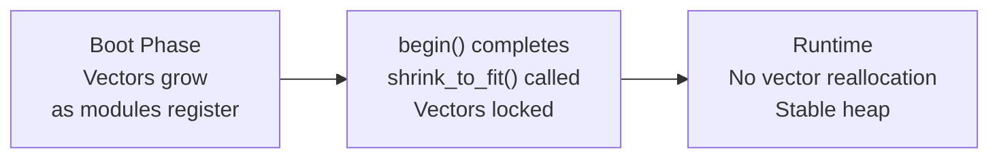
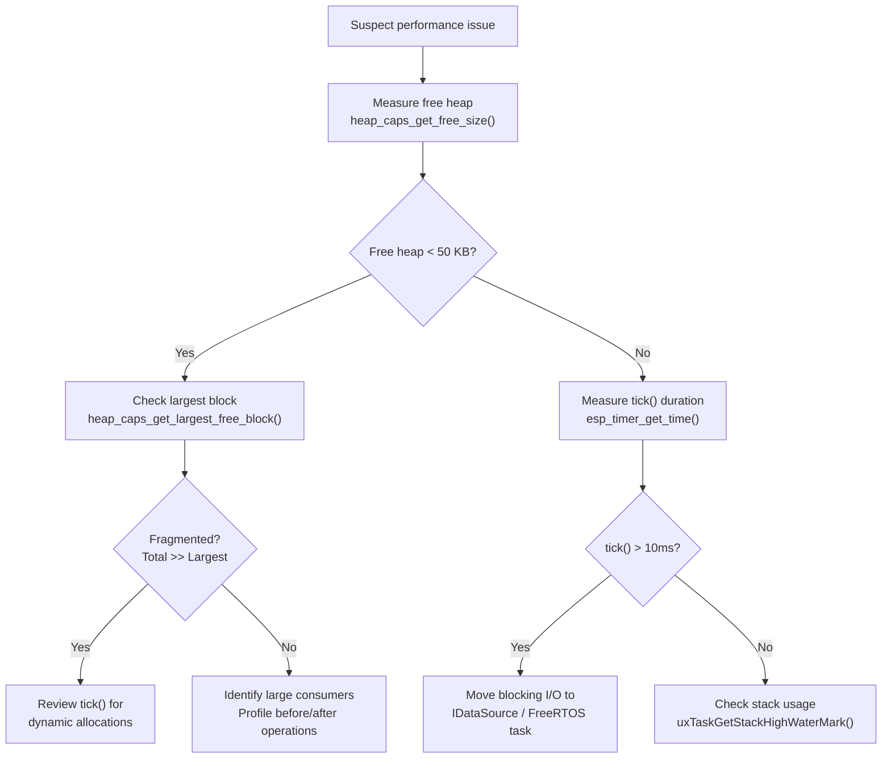

# Performance Guide

> ESP32 App Foundation (c) 2026 CB Labs
>
> Hardware constraints, RAM budgeting, TLS memory management, PSRAM utilisation, flash partitioning, and profiling techniques for ESP32 applications.

---

This guide explains how to measure and optimise performance in the ESP32 App Foundation. Embedded systems have fixed resources — understanding where every kilobyte goes is the difference between a device that runs for years and one that crashes overnight.

**Prerequisites:** Read the [Architecture Overview](architecture-overview.md) and [Coding Patterns](coding-patterns.md) first.

---

## 1. ESP32 Hardware Overview

The framework supports multiple ESP32 variants. Understanding their capabilities determines your memory strategy, partition scheme, and feature set.

### Comparison Table

| Feature | ESP32 (Classic) | ESP32-S3 |
| :--- | :--- | :--- |
| **CPU** | Dual-core Xtensa LX6, 240 MHz | Dual-core Xtensa LX7, 240 MHz |
| **Internal SRAM** | ~520 KB total (~320 KB usable after boot) | ~512 KB total (~400 KB usable after boot) |
| **PSRAM** | Typically none (external chips possible) | Often 2 MB or 8 MB (Octal SPI) |
| **Typical Flash** | 4 MB | 8 MB – 16 MB |
| **WiFi** | 802.11 b/g/n | 802.11 b/g/n |
| **Bluetooth** | BT 4.2 + BLE | BT 5.0 + BLE |
| **USB** | None (UART bridge) | Native USB (OTG) |

### Typical Free Heap After Framework Boot

After the framework completes its `begin()` phase (WiFi connected, config loaded, web server started, all modules registered), expect:

| Variant | Free Internal Heap | Largest Free Block |
| :--- | :--- | :--- |
| ESP32 Classic (no PSRAM) | ~80 KB – 120 KB | ~60 KB – 80 KB |
| ESP32-S3 (with 8 MB PSRAM) | ~150 KB – 200 KB internal | ~100 KB+ internal |

> [!IMPORTANT]
> These numbers vary significantly based on which modules are registered, how many web routes exist, and whether TLS connections are active. Always measure your specific configuration.

---

## 2. RAM Budgeting

Memory is the single most constrained resource on the ESP32. Every module, every connection, and every buffer competes for the same finite pool of internal SRAM.

### Budgeting Targets

| Threshold | Value | Meaning |
| :--- | :--- | :--- |
| **Runtime Target** | > 150 KB free | Healthy module-loaded application at idle |
| **Absolute Minimum** | ≥ 50 KB free | Below this, TLS handshakes may fail |
| **Critical** | < 30 KB free | System instability, potential OOM crashes |

### Where Memory Goes

Understanding the major consumers helps you plan capacity:

| Consumer | Approximate Cost | Notes |
| :--- | :--- | :--- |
| WiFi stack | ~40 KB | Reserved by ESP-IDF during `WiFi.begin()` |
| TLS connection (active) | ~20 – 30 KB | Per connection, idle state |
| TLS handshake (peak) | ~40 – 50 KB | Transient during connection setup |
| ArduinoJson document | 1 – 16 KB | Depends on document size |
| Display buffer (U8G2, 128×64) | ~1 KB | Per full-screen buffer |
| Web server (PsychicHttp) | ~5 – 10 KB | Connection pool and handlers |
| EventBus subscriptions | ~0.5 KB | Static function pointers, minimal overhead |

### Static vs Dynamic Allocation

Favour static allocation wherever possible. Static memory is reserved at compile time, making `.bss` and `.data` sizes visible in build logs. Dynamic allocation (`new`, `malloc`) hides memory consumption until runtime, when it's harder to diagnose.

```cpp
// ✅ Static allocation — visible in build logs
class MyModule : public ITickable {
    char _buffer[256];            // Compile-time reservation
    JsonDocument _doc;                // ArduinoJson v7 unified type
};

// ❌ Dynamic allocation — hidden until runtime
class MyModule : public ITickable {
    char* _buffer = nullptr;
    void begin() {
        _buffer = new char[256]; // Invisible to the linker
    }
};
```

---

## 3. Heap Management

### The Two-Tier Vector Model

The framework prevents continuous reallocation and fragmentation as module vectors grow during boot:

1. **Initial Reserve:** The framework reserves capacity upfront for the anticipated number of modules.
2. **Compact and Lock:** At the end of `Application::begin()`, the framework calls `shrink_to_fit()` on all major module vectors and locks them, converting them to a read-only list for the duration of runtime.

This guarantees that vectors use the exact amount of memory needed, returning unused reserved capacity to the heap.



### Monitoring the Heap

The framework publishes real-time heap telemetry via the EventBus:

- **Topic:** `system.heap`
- **Payload:** `SystemHeapPayload` containing `free_heap_bytes` and `minimum_free_heap_bytes`

To manually query heap state at any point in your code:

```cpp
#include <esp_heap_caps.h>

void logHeapStatus(const char* label) {
    size_t free_heap = heap_caps_get_free_size(MALLOC_CAP_INTERNAL);
    size_t largest_block = heap_caps_get_largest_free_block(MALLOC_CAP_INTERNAL);
    ESP_LOGI(TAG, "[%s] Free heap: %zu bytes, Largest block: %zu bytes",
             label, free_heap, largest_block);
}
```

> [!WARNING]
> **`heap_caps_get_free_size()` ≠ allocatable memory.** Total free heap can report 60 KB, but if the largest contiguous block is only 20 KB, a 30 KB TLS allocation will still fail. Always check `heap_caps_get_largest_free_block()` for TLS readiness.

### Anti-Fragmentation Rules

1. **No Heap Allocation in `tick()` Loops** — Code inside `tick()` executes dozens of times per second. `new`, `malloc`, `String` concatenation, and `std::vector::push_back()` inside `tick()` will fragment the heap within hours. Pre-allocate buffers as class members during `begin()`.

2. **Avoid Arduino `String`** — Arduino's `String` class uses hidden dynamic allocation and concatenation operations that fragment the heap quickly. Use `std::string`, `const char*`, or fixed-size `char` arrays. If `String` is unavoidable, call `reserve()` upfront.

3. **Pre-allocate Buffers** — For repeated I/O operations (serial parsing, HTTP responses), allocate the buffer once at initialisation and reuse it.

```cpp
// ✅ Pre-allocated buffer — no runtime allocation
class SensorModule : public ITickable {
    char _responseBuffer[512];  // Allocated once, reused every tick

    void tick(uint32_t now) override {
        // Use _responseBuffer for serial reads — zero allocations
    }
};
```

---

## 4. TLS Memory

TLS connections (HTTPS, MQTT over TLS) are the **single largest consumer of RAM** in ESP32 applications. A single misconfigured TLS handshake can consume all available heap and crash the device.

### The TLS Handshake Cost

| Phase | Memory Cost |
| :--- | :--- |
| **Handshake Peak** | ~40 KB – 50 KB contiguous |
| **Connection Idle** | ~20 KB – 30 KB |
| **Connection Teardown** | Memory returned to heap (but may be fragmented) |

> [!CAUTION]
> The handshake requires a **contiguous** block of memory. Even if total free heap is 60 KB, if fragmentation has reduced the largest contiguous block to 25 KB, the handshake will fail with an `mbedtls` allocation error. Use `heap_caps_get_largest_free_block(MALLOC_CAP_INTERNAL)` to check contiguous availability before initiating TLS connections.

### WiFiClientSecure Placement (ADR-14)

`WiFiClientSecure` objects are exceptionally large (often > 500 bytes for the object alone, plus internal buffers). They must **never** be placed on the stack:

```cpp
// ❌ Stack allocation — will overflow a FreeRTOS task stack
void fetchData() {
    WiFiClientSecure client;  // > 500 bytes on the stack!
    client.connect(host, 443);
}

// ✅ Heap allocation — controlled lifetime
class MyDataSource : public IDataSource {
    std::unique_ptr<WiFiClientSecure> _client;

    void begin() {
        _client = std::make_unique<WiFiClientSecure>();
    }

    UpdateStatus fetchUpdate() override {
        _client->connect(_host, 443);
        // ... fetch data ...
        return UpdateStatus::Success;
    }
};

// ✅ Member variable — lifetime tied to module
class MyDataSource : public IDataSource {
    WiFiClientSecure _client;  // Member, not local
};
```

### mbedTLS Configuration Tuning

Reduce memory pressure by optimising `sdkconfig`:

| Setting | Default | Recommended | Savings |
| :--- | :--- | :--- | :--- |
| `MBEDTLS_SSL_MAX_CONTENT_LEN` | 16384 | 4096 or 8192 | ~8 – 12 KB per connection |
| Dynamic buffer allocation | Often disabled | Enable | Allocates only what's needed |

> [!NOTE]
> Reducing `MBEDTLS_SSL_MAX_CONTENT_LEN` to 4096 requires the server to support TLS fragment sizes ≤ 4096. Most modern servers do, but verify before deploying.

### Cipher Suite Selection

Constrained devices should limit the allowed cipher suites to faster, more memory-efficient options:

| Recommended Cipher | Why |
| :--- | :--- |
| `TLS_ECDHE_ECDSA_WITH_AES_128_GCM_SHA256` | Fast ECDSA verification, 128-bit AES, low memory |
| `TLS_ECDHE_RSA_WITH_AES_128_GCM_SHA256` | RSA fallback, still efficient |

Avoid 256-bit AES or slower Diffie-Hellman suites unless your security policy explicitly requires them.

### Connection Pooling

Avoid tearing down and re-establishing TLS connections on every fetch cycle. Each handshake costs ~40-50 KB of transient heap. Instead:

1. Keep the `WiFiClientSecure` as a module member variable.
2. Reuse the connection across fetch cycles where the server supports HTTP keep-alive.
3. Only reconnect when the connection drops or the server closes it.

### TLS Memory Optimization

The framework's `sdkconfig.defaults` includes mbedTLS tuning (introduced in PR-29) that significantly reduces TLS heap consumption. These are pure `sdkconfig` changes — zero source code modifications.

#### Key sdkconfig Settings

| Setting | Effect | Savings |
| :--- | :--- | :--- |
| `CONFIG_MBEDTLS_DYNAMIC_BUFFER=y` | TX/RX buffers allocated on-demand, freed when idle | ~16–20 KB per idle connection |
| `CONFIG_MBEDTLS_SSL_KEEP_PEER_CERTIFICATE=n` | Discards peer cert after handshake verification | ~2–3 KB per connection |
| `CONFIG_MBEDTLS_CERTIFICATE_BUNDLE_DEFAULT_NONE=y` | Disables built-in Mozilla CA bundle (framework uses `setCACert()`) | Reduces flash footprint |
| `CONFIG_MBEDTLS_SSL_RENEGOTIATION=n` | Disables TLS renegotiation (security anti-pattern) | Code size reduction |
| `CONFIG_MBEDTLS_CLIENT_SSL_SESSION_TICKETS=n` | Disables session tickets (marginal benefit for short-lived connections) | Code size reduction |

> [!IMPORTANT]
> The 16 KB RX buffer (`CONFIG_MBEDTLS_SSL_IN_CONTENT_LEN=16384`) **cannot be reduced**. CDNs (Fastly, Cloudflare) send full-size TLS records. A smaller buffer causes `MBEDTLS_ERR_SSL_BUFFER_TOO_SMALL` failures.

#### Measured Results (ESP32-S3 NanoS3)

| Metric | Before Optimization | After Optimization | Delta |
| :--- | :--- | :--- | :--- |
| Idle free heap | 148,683 B | 167,495 B | **+18,812 (+12.7%)** |
| Minimum free heap | 86,063 B | 140,035 B | **+53,972 (+62.7%)** |
| Largest free block | 71,680 B | 90,112 B | **+18,432 (+25.7%)** |

After a full CA-validated TLS handshake + GitHub API call, `heap_min_free` never dropped below **124 KB** (vs 86 KB pre-optimization).

#### Certificate Bundle Modes

The framework defaults to `DEFAULT_NONE` because its own connections don't need the bundle (`GithubClient` pins its CA; OTA uses `setInsecure()` with payload verification). Downstream apps that need to connect to arbitrary HTTPS servers should re-enable the bundle:

| Mode | CAs Included | Flash Cost |
| :--- | :--- | :--- |
| `DEFAULT_NONE` | None (framework default) | Minimal |
| `DEFAULT_CMN` | ~35 most common CAs | ~15 KB |
| `DEFAULT_FULL` | ~130 CAs (full Mozilla set) | ~60 KB |

Override in your board-specific `sdkconfig.defaults.*`:

```ini
# Re-enable the "Most Common" bundle
CONFIG_MBEDTLS_CERTIFICATE_BUNDLE_DEFAULT_NONE=n
CONFIG_MBEDTLS_CERTIFICATE_BUNDLE_DEFAULT_CMN=y
```

> [!WARNING]
> Setting `DEFAULT_NONE` while keeping `CONFIG_MBEDTLS_CERTIFICATE_BUNDLE=y` preserves the bundle API — downstream code can still call `esp_crt_bundle_attach()`. It only removes the default CA certificates. If you disable the bundle entirely (`CONFIG_MBEDTLS_CERTIFICATE_BUNDLE=n`), any code calling the bundle API will fail to link.

---

## 5. PSRAM

Pseudo-Static RAM (PSRAM) extends the ESP32's available memory but comes with critical performance and safety caveats.

### Hardware Availability

| Variant | PSRAM | Interface |
| :--- | :--- | :--- |
| ESP32 (Classic) | Typically none | External chips require specific pin configs |
| ESP32-S3 | Often 2 MB or 8 MB | Octal SPI (OPI), high throughput |

### Detection and Allocation

To explicitly allocate memory in PSRAM:

```cpp
#include <esp_heap_caps.h>

// Allocate a large buffer in PSRAM
void* buffer = heap_caps_malloc(size, MALLOC_CAP_SPIRAM);
if (buffer == nullptr) {
    ESP_LOGE(TAG, "PSRAM allocation failed — PSRAM may not be available");
    // Fall back to internal RAM or reduce buffer size
}
```

> [!IMPORTANT]
> If PSRAM is unavailable, `heap_caps_malloc(size, MALLOC_CAP_SPIRAM)` returns `nullptr`. Always check the return value.

### When to Use PSRAM

| Use Case | PSRAM? | Reason |
| :--- | :--- | :--- |
| Large display buffers (TFT, e-ink) | ✅ Yes | Too large for internal RAM |
| Large JSON parsing payloads | ✅ Yes | Avoids fragmenting internal heap |
| Audio buffers | ✅ Yes | Typically > 8 KB |
| ISR context variables | ❌ Never | PSRAM inaccessible during cache-disabling operations (e.g., flash writes) |
| High-frequency data access (DSP loops) | ❌ Avoid | SPI latency causes timing jitter |
| `ITickable` core logic with deterministic timing | ❌ Avoid | SPI access latency is unpredictable |

### Stack in PSRAM

For large FreeRTOS tasks that don't fit in internal RAM, the task stack can be placed in PSRAM:

```cpp
// Place a large task stack in PSRAM (ESP32-S3 only)
xTaskCreateStatic(
    taskFunction,
    "BigTask",
    32768,           // 32 KB stack — too large for internal RAM
    nullptr,
    1,
    psramStackBuffer, // Buffer allocated via heap_caps_malloc(MALLOC_CAP_SPIRAM)
    &taskControlBlock
);
```

> [!WARNING]
> A stack in PSRAM is significantly slower. Function calls and local variable access have higher latency due to SPI bus overhead. Profile your task performance after moving to PSRAM.

### Speed Tradeoffs

| Memory Type | Access Speed | Latency |
| :--- | :--- | :--- |
| Internal SRAM | ~1 cycle | Deterministic |
| PSRAM (Octal SPI, 80 MHz) | High throughput | Higher latency, bus contention |
| PSRAM (Quad SPI, 40 MHz) | Moderate throughput | Significantly higher latency |

---

## 6. Flash Size Budgeting

Effective flash management determines how large your firmware can grow and whether OTA (Over-The-Air) updates are possible. OTA requires **two app partitions of equal size** — so a 2 MB firmware needs at least 4 MB of flash just for code.

### Partition Schemes by Variant

| Flash Size | Variant | Partition Scheme | App Partition | LittleFS Space |
| :--- | :--- | :--- | :--- | :--- |
| **4 MB** | ESP32 Classic | `default.csv` | ~1.2 MB (OTA) or ~1.9 MB (no OTA) | Heavily restricted |
| **8 MB** | ESP32-S3 | `default_8MB.csv` | ~3.0 MB per app partition | Generous |
| **16 MB** | ESP32-S3 | `default_16MB.csv` | ~3.2 MB per app partition | Massive (> 8 MB for web assets) |

Select the scheme in `platformio.ini`:

```ini
; For ESP32-S3 with 16MB flash
board_build.partitions = default_16MB.csv
```

### Firmware Size Monitoring

Keep compiled firmware **below 2.0 MB** if possible. Monitor firmware size in your build output:

```
RAM:   [===       ]  32.5% (used 106692 bytes from 327680 bytes)
Flash: [========  ]  78.3% (used 1632456 bytes from 2085888 bytes)
```

### Compiler Flags for Size Reduction

| Flag | Purpose | Trade-off |
| :--- | :--- | :--- |
| `-Os` | Optimise for size | Slightly slower execution |
| `-O2` | Optimise for speed | Larger binary |

Configure in `platformio.ini`:

```ini
build_unflags = -O2
build_flags = -Os
```

### Stripping Unused ESP-IDF Components

Disable unused features in `sdkconfig` to reduce binary size:
- Disable Bluetooth if you only use WiFi.
- Disable unused network protocols (PPP, SLIP).
- Disable ESP-MQTT if you don't use MQTT.

---

## 7. Profiling Techniques

You cannot optimise what you cannot measure. The ESP32 provides several built-in profiling mechanisms.

### Measuring Heap Usage

Use `heap_caps_get_free_size()` before and after large operations to identify leaks or excessive consumption:

```cpp
#include <esp_heap_caps.h>

// Profile a specific operation
size_t before = heap_caps_get_free_size(MALLOC_CAP_INTERNAL);

// ... perform operation (JSON parse, HTTPS fetch, etc.) ...

size_t after = heap_caps_get_free_size(MALLOC_CAP_INTERNAL);
ESP_LOGI(TAG, "Operation consumed %d bytes of heap", (int)(before - after));
```

### Measuring Stack Usage

FreeRTOS tasks have a fixed stack size. Use `uxTaskGetStackHighWaterMark()` to check how close a task came to overflowing:

```cpp
UBaseType_t highWaterMark = uxTaskGetStackHighWaterMark(NULL);
ESP_LOGI(TAG, "Task stack high water mark: %u words (%u bytes)",
         highWaterMark, highWaterMark * 4);
```

> [!NOTE]
> The returned value is in **words** (4 bytes each on ESP32), not bytes. Multiply by 4 to get the byte count. Check ESP-IDF documentation for your specific port.

### Measuring Execution Time
 
 Profile `tick()` functions and rendering loops to ensure they stay within the **mandatory 10ms budget** (as per the `ITickable` contract):
 
 ```cpp
 #include <esp_timer.h>
 
 int64_t start = esp_timer_get_time();  // Microseconds since boot
 
 // ... code to measure ...
 
 int64_t elapsed = esp_timer_get_time() - start;
 if (elapsed > 10000) {  // 10ms = 10000µs
     ESP_LOGW(TAG, "tick() exceeded 10ms budget: %lld µs", elapsed);
 }
 ```

### FreeRTOS Runtime Stats

If `configGENERATE_RUN_TIME_STATS` is enabled in `sdkconfig`, dump CPU utilisation per task:

```cpp
char statsBuffer[1024];
vTaskGetRunTimeStats(statsBuffer);
ESP_LOGI(TAG, "Task Stats:\n%s", statsBuffer);
```

This is critical for identifying tasks that are starving the idle task or triggering the Task Watchdog Timer (TWDT).

### Profiling Workflow



---

## See Also

- [Architecture Overview](architecture-overview.md) — System design and lifecycle
- [Coding Patterns](coding-patterns.md) — Modules vs Libraries, SOLID, anti-patterns
- [Embedded Safety](embedded-safety.md) — Thread safety, memory rules, power management
- [Scheduling Data Fetches](scheduling-data-fetches.md) — `IDataSource` and `DataManager`
- [Build System](build-system.md) — PlatformIO configuration
