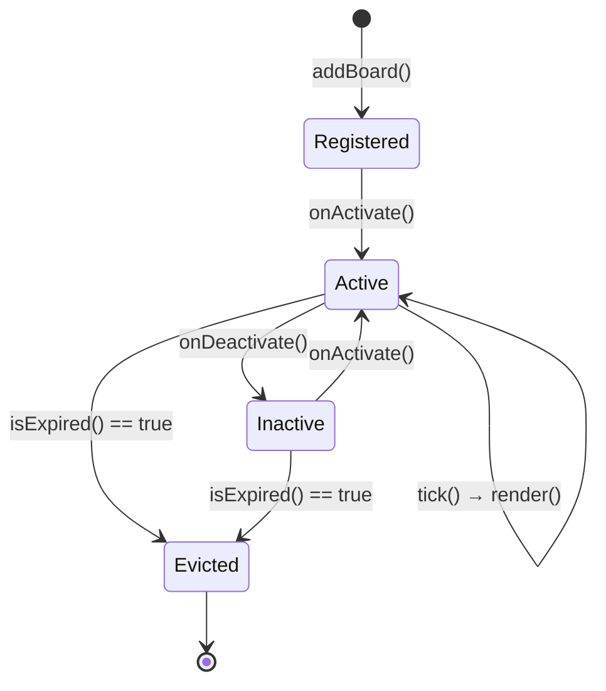

# Using Optional Modules

> ESP32 App Foundation (c) 2026 CB Labs
>
> Learn how to integrate platform-specific and feature-specific optional modules using the two-axis optionality model and explicit main.cpp composition pattern.

---

This guide explains how to work with **optional modules**: framework-level or application-level modules that add hardware-specific or feature-specific capabilities not every application needs. Because optional modules may depend on hardware SDKs or optional protocols (such as HomeAssistant MQTT), they follow a clean two-axis optionality model.

For the base module creation pattern, see [Creating a Module](creating-a-module.md).

---

## 1. What "Optional" Means & The Two-Axis Optionality Model

An **optional module** is any module (framework-level or application-level) that:

- Depends on hardware-specific libraries (SPI drivers, sensor SDKs, display controllers) or optional protocols (e.g., HomeAssistant MQTT)
- Is not required by every downstream application
- Can be excluded to reduce flash size, save RAM, or enable host-based unit testing (`native`)

### The Two-Axis Optionality Model

The framework governs optionality along two independent axes:

1. **Axis 1: Availability Flag (Compile-Time)** — Governed by preprocessor defines in `platformio.ini` (e.g., `-D WITH_HOMEASSISTANT`, `-D WITH_DISPLAY_U8G2`). When the flag is off, `#ifdef` guards exclude the module's headers and compilation units entirely, preserving binary flash and RAM space.
2. **Axis 2: Explicit Composition (Registration)** — Framework optional modules (such as `HomeAssistantModule`) are no longer owned or hardcoded inside `Application`. Instead, they are explicitly instantiated and wired in `main.cpp` and registered via `app.registerModule()`, guarded by the feature flag.

This "honest `main.cpp` composition pattern" keeps `Application` decoupled as a core kernel hub, while making all optional dependencies explicit in the application entry point.

Examples in the framework include:
- **HomeAssistantModule** — MQTT discovery and telemetry reporting (guarded by `WITH_HOMEASSISTANT`)
- **U8G2DisplayModule** — Monochrome OLED/LCD display driver via SPI/I2C (guarded by `WITH_DISPLAY_U8G2`)
- **LVGLDisplayModule** — Colour TFT display driver powered by LVGL v9.5 (guarded by `WITH_DISPLAY_LVGL`)

Optional modules are full framework citizens: they implement the same interfaces (`ITickable`, `IConfigurable`, `IWebContributor`, etc.) and are registered with the same `registerModule()` call.

---

## 2. The `#ifndef NATIVE_BUILD` Guard Pattern

### Why It Exists

The framework supports two build environments (see [Build System](build-system.md)):
- **Hardware environments** (`esp32dev`, `esp32s3nano`) — compile with the full Arduino + ESP-IDF toolchain
- **Native environment** (`native`) — compiles with the host CPU's C++ compiler for GoogleTest, with `-DNATIVE_BUILD` defined

Hardware-specific headers like `<U8g2lib.h>`, `<Wire.h>`, or `<SPI.h>` do not exist on the host machine. If your module `#include`s them unconditionally, the native build will fail to compile.

### How to Use It

Wrap all hardware-specific includes and member variables in `#ifndef NATIVE_BUILD` guards:

```cpp
#pragma once

#include "interfaces/ITickable.hpp"

// --- Hardware-only includes ---
#ifndef NATIVE_BUILD
#include <U8g2lib.h>
#include <ArduinoJson.h>
#endif

class MyDisplayModule : public ITickable {
public:
    void tick(uint32_t currentMillis) override;

private:
#ifndef NATIVE_BUILD
    // Hardware driver — only exists on target builds
    U8G2_SSD1306_128X64_NONAME_F_HW_I2C _u8g2{U8G2_R0};
    const uint16_t _displayWidth  = _u8g2.getDisplayWidth();
    const uint16_t _displayHeight = _u8g2.getDisplayHeight();
#else
    // Native build defaults for test consistency
    const uint16_t _displayWidth  = 128;
    const uint16_t _displayHeight = 64;
#endif
};
```

### What Happens If You Forget

If you omit the guard:
1. `pio run -e native` will fail with "file not found" errors for hardware headers
2. All unit tests will be blocked from compiling
3. CI pipelines that run native tests will break

---

## 3. Display Module — Worked Example

The [U8G2DisplayModule](../../modules/U8G2Display/U8G2DisplayModule.hpp) is the most complex optional module in the framework. It demonstrates how a hardware-dependent module can implement five interfaces and expose sub-objects while remaining fully guarded for native builds.

> [!IMPORTANT]
> U8G2 is a **replaceable reference implementation**, not a mandatory component. The framework's display architecture is designed so that downstream applications can swap to TFT, e-ink, or headless operation. See [Replacing the Display](#replacing-the-display) below.

### Interfaces Implemented

| Interface | Purpose |
|:---|:---|
| `ITickable` | Carousel rotation, sleep check, frame rendering |
| `IStatusReporter` | Boot progress display via `BootBoard` and `ErrorBoard` |
| `IConfigurable` | Persistent display settings (namespace: `"display"`, schema v3) |
| `IWebContributor` | REST API routes under `/api/display/*` and portal tab |
| `IMCPContributor` | `display_status` (read-safe) and `display_control` (mutating) MCP tools |

### Sub-Object Registration

The display module exposes its internal components as sub-objects and uses inner stub classes for sub-tab navigation in the web portal:

```cpp
// Inner struct — provides a "Settings" sub-pill under the "Display" parent tab
struct SettingsTabStub : public IWebContributor {
    void        registerRoutes(PsychicHttpServer& /*server*/) override {}
    const char* getTabName()   const override { return "Settings"; }
    const char* getParentTab() const override { return "Display";  }
    int         getTabOrder()  const override { return 10;         }
};

// Expose for external registration
IWebContributor* settingsTabStub()   { return &_settingsTabStub;   }
IWebContributor* screenshotTabStub() { return &_screenshotTabStub; }
```

These stubs are registered as separate modules by `Application::begin()`:

```cpp
// In Application::begin() — registering display sub-objects
app.registerModule(&display);                       // Main display module
app.registerModule(display.settingsTabStub());      // Settings sub-pill
app.registerModule(display.screenshotTabStub());    // Screenshot sub-pill
```

Each sub-object is a full `IWebContributor` that appears as a child tab. The stubs carry no routes of their own — all REST endpoints are registered by the parent module via `registerRoutes()`.

### Two-Phase Hardware Bootstrap

The display uses a two-phase initialization pattern to show boot progress before the framework is fully initialized:

1. **Phase 1 — `bootstrapHardware()`:** Initializes the SPI bus and U8G2 driver with zero framework dependencies. Called *before* `app.begin()` so the display can show boot progress.
2. **Phase 2 — `begin(eventBus)`:** Completes framework integration by subscribing to EventBus topics and locking the board pool. Called *after* `app.begin()`.

### Hardware Guard in the Header

The display driver and geometry pseudo-constants are fully guarded:

```cpp
#ifndef NATIVE_BUILD
    U8G2_DISPLAY_TYPE _u8g2{U8G2_R0, DISPLAY_CS_PIN, DISPLAY_DC_PIN, DISPLAY_RST_PIN};
    const uint16_t _displayWidth  = _u8g2.getDisplayWidth();
    const uint16_t _displayHeight = _u8g2.getDisplayHeight();
#else
    // Native build defaults — match primary hardware target for test consistency
    const uint16_t _displayWidth  = 256;
    const uint16_t _displayHeight = 64;
#endif
```

### The `IDisplayBoard` Interface

The [IDisplayBoard](file:///Users/mcneillm/Documents/Projects/esp32-app-foundation/include/interfaces/IDisplayBoard.hpp) interface defines the contract for any UI board (pane) that participates in the carousel rotation. Each board is a full-screen rendering unit managed by the `CarouselEngine`.

```cpp
class IDisplayBoard {
public:
    virtual ~IDisplayBoard() = default;
    virtual void render(U8G2& u8g2) = 0;
    virtual bool isExpired() const = 0;
    virtual const char* getBoardName() const = 0;
    virtual void onActivate() {}
    virtual void onDeactivate() {}
    virtual void tick(uint32_t currentMillis) {}
};
```

#### Full Lifecycle

The `CarouselEngine` manages board transitions through five lifecycle methods:



| Step | Method | Description |
|:---|:---|:---|
| 1 | `onActivate()` | Called when the board becomes the active rendering target. Reset scroll positions, snapshot telemetry, initialise animations. |
| 2 | `tick(uint32_t currentMillis)` | Called every frame while the board is active. Advance scroll counters, update animation timers. |
| 3 | `render(U8G2& u8g2)` | Called within the U8G2 draw loop. Draw primitives and text to the display buffer. Must be fast — no blocking I/O. |
| 4 | `onDeactivate()` | Called when the board goes off-screen (rotation or manual advance). Release resources, pause animations. |
| 5 | `isExpired()` | Polled by the engine. Return `true` to evict the board from the carousel pool entirely. System boards typically never expire; dynamic notification boards do. |

> [!NOTE]
> `render()` executes synchronously on the main thread and MUST be fast. Do not perform any heavy calculation or network I/O during rendering.

### CarouselEngine API

The `CarouselEngine` orchestrates the rotation of boards in the Content Layer of the display:

| Method | Description |
|:---|:---|
| `addBoard(IDisplayBoard* board)` | Register a new board to the carousel pool |
| `removeBoard(IDisplayBoard* board)` | Unregister a board from the pool |
| `nextBoard()` | Instantly advance to the next board |
| `previousBoard()` | Instantly return to the previous board |
| `pause()` | Halt auto-rotation |
| `resume()` | Resume auto-rotation |

Modules register their boards during the `begin()` phase:

```cpp
void MyModule::begin() {
    app->getDisplay()->getCarousel()->addBoard(&_myBoard);
}
```

The engine iterates the pool sequentially. If `isExpired()` returns `true` for a board, the engine evicts it from the pool entirely.

### ScreensaverController

The `ScreensaverController` manages display power states based on user inactivity. It prevents OLED burn-in and saves power on battery-operated devices.

#### API

| Method | Description |
|:---|:---|
| `resetTimer()` | Reset the inactivity timer to zero (call on any user interaction) |
| `wake()` | Force the display to wake immediately and reset the timer |
| `sleep()` | Force the display to sleep immediately |
| `isSleeping() const` | Query the current power state |
| `setInactivityTimeout(uint32_t ms)` | Configure idle timeout before sleeping |

#### Inactivity Policy

If the `tick()` loop runs for the configured timeout duration without a call to `resetTimer()`, the controller transitions the display to sleep mode. When asleep:
1. The hardware receives a power-down command (e.g., U8G2's `setPowerSave(1)`)
2. The `CarouselEngine` is paused
3. The rendering pipeline is halted to save CPU cycles

#### Display Sleep/Wake Events

Modules can react to screen state changes by implementing the `IScreensaverAware` interface:

```cpp
class IScreensaverAware {
public:
    virtual void onDisplaySleep() = 0;
    virtual void onDisplayWake() = 0;
};
```

When the `ScreensaverController` transitions state, it iterates through all registered `IScreensaverAware` objects, notifying them of the change. This allows modules to pause expensive I2C sensor polling or other unnecessary work when the screen is off.

### 3.4 LVGL Display Module (Colour TFT & Hardware Adapters)

For full-colour TFT screens, the framework provides [LVGLDisplayModule](../../modules/LVGLDisplay/README.md) as a peer to `U8G2DisplayModule`. Powered by LVGL v9.5, it separates generic display lifecycle and framework interface implementation from board-specific hardware drivers using the [`ILVGLHardwareAdapter`](../../include/interfaces/ILVGLHardwareAdapter.hpp) pattern.

#### Architecture Highlights

- **5 Framework Interfaces**: Implements `ITickable`, `IConfigurable`, `IStatusReporter`, `IWebContributor`, and `IMCPContributor`.
- **Hardware Isolation**: Display controllers, touch sensors, encoders, and backlight PWM are implemented in hardware adapters (such as the reference [`CrowPanel128Adapter`](../../adapters/lvgl/CrowPanel128Adapter.hpp)).
- **Two-Stage Boot Splash (D8)**: Displays a Stage-1 compiled-in boot logo during Phase 1 (`bootstrapHardware()`) before LittleFS or ConfigManager mount, and handsoff to SquareLine Studio UI via `ui_init()`.
- **Asset Storage & 16 MB Requirement (D9)**: UI graphics and fonts are compiled directly into the binary (`rodata`), ensuring asset updates flow through standard firmware OTA without touching LittleFS config. Requires a minimum of **16 MB Flash memory** (`partitions.esp32s3nano.csv`).

For full details, see the [LVGLDisplayModule README](../../modules/LVGLDisplay/README.md) and [Adapter Authoring Guide](../../adapters/lvgl/README.md).

---

## 4. Adding Your Own Optional Module

Follow this recipe to create a new hardware-dependent module:

### Step 1 — Create Your Module Class

Implement the interfaces your module needs. See [Creating a Module](creating-a-module.md) for the base pattern.

```cpp
// modules/MySensor/MySensorModule.hpp
#pragma once

#include "interfaces/ITickable.hpp"
#include "interfaces/IDataSource.hpp"

#ifndef NATIVE_BUILD
#include <Wire.h>
#include "MySensorDriver.h"
#endif

class MySensorModule : public ITickable, public IDataSource {
public:
    void tick(uint32_t currentMillis) override;

    // IDataSource
    UpdateStatus  fetchUpdate() override;
    uint32_t      getUpdateIntervalMs() const override { return 60000; }
    const char*   getSourceName() const override { return "my_sensor"; }
    PriorityTier  getPriorityTier() const override { return PriorityTier::Normal; }

private:
#ifndef NATIVE_BUILD
    MySensorDriver _driver;
#endif
    float _lastReading = 0.0f;
};
```

### Step 2 — Guard Hardware Code in the Implementation

Provide both real and no-op implementations:

```cpp
// modules/MySensor/MySensorModule.cpp
#include "MySensorModule.hpp"

void MySensorModule::tick(uint32_t currentMillis) {
    // Non-blocking periodic logic (works on both targets)
}

#ifndef NATIVE_BUILD
UpdateStatus MySensorModule::fetchUpdate() {
    // Real hardware read on the DataManager's FreeRTOS task
    _lastReading = _driver.readTemperature();
    return UpdateStatus::Success;
}
#else
UpdateStatus MySensorModule::fetchUpdate() {
    // No-op for native test builds
    return UpdateStatus::Success;
}
#endif
```

### Step 3 — Register in main.cpp

```cpp
#include "AppFoundation.h"
#include "myApp.hpp"

#ifndef NATIVE_BUILD
#include "MySensorModule.hpp"
MySensorModule sensor;
#endif

Application app;
MyApp myApp;

void setup() {
    app.registerModule(&myApp);

#ifndef NATIVE_BUILD
    app.registerModule(&sensor);
#endif

    FrameworkConfig config;
    app.begin(config);
}
```

> **Important:** The `#include` and global instantiation of the sensor module are *both* guarded. If you only guard the `registerModule()` call but not the `#include`, the native build will still fail because the hardware header is parsed.

### Framework Optional Module Example: HomeAssistantModule

Framework optional modules follow the exact same composition rules as custom modules. Rather than being owned inside `Application`, `HomeAssistantModule` is declared statically at file scope in `main.cpp`, wired with its kernel dependencies, and registered with `app.registerModule()` guarded by `#ifdef WITH_HOMEASSISTANT`:

```cpp
#include "AppFoundation.h"

static Application app;

#ifdef WITH_HOMEASSISTANT
#include "HomeAssistantModule.hpp"
static HomeAssistantModule haModule;
#endif

void setup() {
    // Basic framework setup
    app.getWifiManager().setDefaultHostname("esp32-foundation");

#ifdef WITH_HOMEASSISTANT
    // Inject core kernel dependencies before registering
    haModule.setKeyManager(&app.getKeyManager());
    haModule.setEventBus(&app.getEventBus());
    haModule.setConfigManager(&app.getConfigManager());
    haModule.setAppName(app.getAppName());
    haModule.setAppVersion(BUILD_VERSION);

    // Register the optional module with the framework hub
    app.registerModule(&haModule);
#endif

    FrameworkConfig config;
    app.begin(config);
}
```

### Step 4 — Provide Native Build Stubs or Mocks

For unit testing, you have two options:

1. **Guard with `#else` blocks** (shown above) — provide a no-op implementation for each method that touches hardware.
2. **Create a mock class** — use GoogleTest's `gmock` to create a mock that can be injected during tests.

---

## 5. Developer Checklist

When creating optional modules:

- [ ] **Guard all hardware includes** with `#ifndef NATIVE_BUILD`
- [ ] **Guard hardware member variables** — provide native-build defaults for any values tests depend on
- [ ] **Guard the global instantiation** in `main.cpp` — both the `#include` and the variable declaration
- [ ] **Test the native build** — run `pio run -e native` to verify compilation succeeds
- [ ] **Follow the 10ms tick budget** — optional modules are still bound by the main-loop timing contract
- [ ] **Use `registerModule()`** — never manually register with individual subsystems; the universal API handles it

---

## 6. Replacing the Display

The framework is designed to allow complete replacement of the display hardware and rendering paradigm. U8G2 is the **reference implementation**, not a hard dependency.

### ADR-02 Rationale: No Unified `IDisplayDriver`

Early designs considered an `IDisplayDriver` interface that would abstract drawing primitives (e.g., `drawLine`, `drawText`). This approach was explicitly rejected in **ADR-02**.

The rationale: drawing paradigms between monochromatic OLEDs (U8G2), full-colour TFTs (TFT_eSPI), and e-ink displays (GxEPD) are fundamentally incompatible. Abstraction layers either become heavily bloated "god interfaces" or restrict developers to the lowest common denominator. Instead, the framework embraces **native types** — if you use U8G2, your boards receive a `U8G2&` reference. If you swap to TFT_eSPI, you rewrite your boards to accept a `TFT_eSPI&` reference.

> [!IMPORTANT]
> The framework manages *orchestration* (carousel rotation, screensaver timeout, panic rendering) but leaves *rendering* explicitly coupled to the chosen hardware library. Swapping the display means rewriting all custom board `render()` implementations.

### How to Swap U8G2 for TFT / E-Ink / Headless

#### Step 1 — Implement a New DisplayManager

Create a new class that manages the hardware lifecycle:

```cpp
class TftDisplayManager {
public:
    void begin();       // Initialise hardware and backlight
    void tick();        // Drive the rendering pipeline
    void panic(const char* message);  // Render crash/panic screen
};
```

#### Step 2 — Decide Which Framework Patterns to Support

| Pattern | What You Need |
|:---|:---|
| Carousel | Implement a `TftCarouselEngine` and define a new `ITftDisplayBoard` interface |
| Screensaver | Implement a `ScreensaverController` that controls TFT backlight |
| Status bar | Provide an API for modules to push status icons via `IStatusContributor` |

#### Step 3 — Update Application Ownership

The `Application` class owns the display so it can guarantee panic rendering:
1. Remove the `U8g2DisplayManager` instantiation in the main application file
2. Instantiate your `TftDisplayManager`
3. Update the `AppFoundation::panic()` hook to route to your new display manager

#### Step 4 — Headless Operation

If the device requires no display at all:
1. Define `#define HEADLESS_MODE`
2. Provide a `NullDisplayManager` with empty `begin()`, `tick()`, and `panic()` methods
3. The framework will gracefully operate without hardware, logging panics to serial instead of attempting to render them
